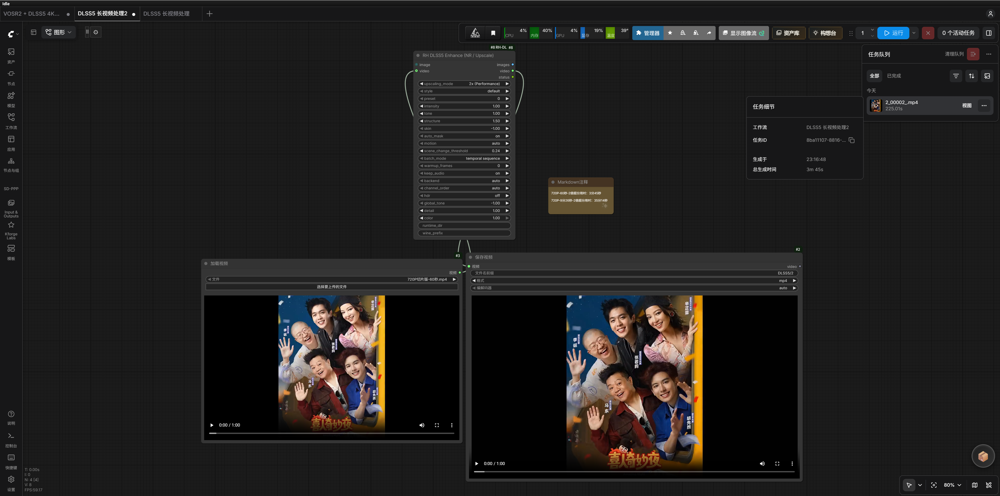
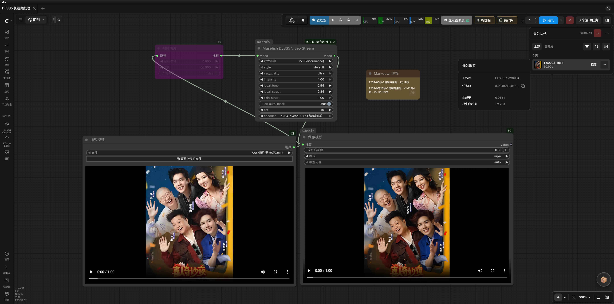

# ComfyUI-Musefish-Nodes

**English** | [简体中文](README.zh-CN.md)

ComfyUI custom nodes for video/audio upscaling, DLSS5 enhancement, media download, ASR and music mastering, plus [Musefish Studio](studio/README.md) — a local desktop client that runs these workflows without the ComfyUI web UI. Every registered node ID uses the `musefish_` prefix; type `musefish_` into the canvas search to list the pack. Legacy CamelCase IDs are no longer registered.

## Install

1. Stop ComfyUI. In your `ComfyUI/custom_nodes` directory: `git clone https://github.com/Brian98Z/ComfyUI-Musefish-Nodes.git`. Without Git, extract the repository ZIP there and rename the folder so that `custom_nodes/ComfyUI-Musefish-Nodes/__init__.py` exists — a nested extra folder hides the pack.
2. Install dependencies with the Python that **launches this ComfyUI instance**, never system Python and never a second PyTorch build:

   ```powershell
   & "../python_embeded/python.exe" -m pip install -r "custom_nodes/ComfyUI-Musefish-Nodes/requirements.txt"
   & "../python_embeded/python.exe" -m pip install opencv-python yt-dlp
   ```

   The layout above is the Windows portable bundle (`ComfyUI/` next to `python_embeded/`); substitute your launcher's real path, e.g. `../.venv/Scripts/python.exe` or `../.venv/bin/python`. Skip OpenCV if `import cv2` already succeeds; never mix GUI and headless OpenCV variants.
3. Restart ComfyUI and search `musefish_` on the canvas. If nothing appears, read the startup console for the first plugin import error; installing packages without a restart does not reload nodes.

## Nodes

| Purpose | Node IDs | Key parameters and constraints | Guide |
| --- | --- | --- | --- |
| PiD video upscale + postprocessing | `musefish_pid_batch_video_upscale`, `musefish_autobatch_antiflicker`, `musefish_autobatch_image_sharpen_fs` | Fixed 1024→4096 model path; noise template reused across batches; antiflicker uses adjacent frames; sharpen is frequency-separated with CPU fallback. Start with `steps=4`, `sampler=lcm`, `latent_format=flux`; antiflicker `luma_tmp=15`, `chroma_tmp=20`; portrait sharpening `hard/gaussian/6`, `amount=0.45`, `noise_threshold=0.01`. Feed the **postprocessed IMAGE** into video combine, not PiD's raw VIDEO output | [PiD](doc/PiD_README.en.md) |
| DLSS5 image / streaming video | `musefish_dlss5_neural_render`, `musefish_dlss5_video_stream` | **RTX 50-series only**, proprietary runtimes supplied by you. `Upscale` picks output size, `vsr_quality` picks VSR quality independently. IMAGE float32 batches capped at 1 GiB; streaming VIDEO switches to HEVC `libx265`/`hevc_nvenc` above 4096 px in either dimension (CPU `crf=19`, GPU CQ 27). An 8K file is not native 8K neural detail | [DLSS5](doc/DLSS5_README.en.md) |
| Direct-link download with resume | `musefish_file_downloader` | Any http(s) link (CivitAI b2 / S3 / ModelScope / HF) fetched as parallel ranges, so per-connection throttled CDNs reach real bandwidth; `.part` + state file resume on the same URL. `url` (keep signed parameters), `save_dir` (empty = `output/musefish`), `conns` (default 32, max 64), `proxy` (auto = direct first, then local proxy), `overwrite`, `allow_any_dir` / `MUSEFISH_DOWNLOAD_DIRS`. **Signed links answer HEAD with 401 — validate them with GET** | [File download](doc/FILE_DOWNLOAD_README.en.md) |
| Platform video download | `musefish_video_downloader`, `musefish_wc_video_channels` | YouTube, Bilibili, X, Douyin, Xiaohongshu, and local WeChat Channels decryption; returns file-backed VIDEO + FPS. `url`, `platform=Auto`, `quality=best`, `chunks` (supported sites auto-pick 8). YouTube/X need a local proxy; YouTube/Douyin may need local cookies; WeChat Channels must have its desktop client open playing the target. Cookie files and tokenized URLs are credentials — never publish them | [Video download](doc/VIDEO_DOWNLOAD_README.en.md) |
| UniverSR audio upscale / mastering | `musefish_universr_model`, `musefish_universr_general_audio`, `musefish_universr_speech_audio` | General music/SFX restoration, speech enhancement, content-aware settings, chunked inference. Models at `ComfyUI/models/UniverSR/models/huggingface/<general\|speech>`; downloaded only with `download=true`. Defaults `auto_params=true`, `input_sr=auto`, `ode_steps=4`, `guidance=1.5`, `chunk_sec=15`, `accel=cuDNN TF32`; lower `chunk_sec` when VRAM is short. `stem_mix` needs both model sets plus Demucs | [UniverSR](doc/UNIVERSR_README.en.md) |
| ASR transcription | `musefish_asr` | AUDIO batch → text via faster-whisper multilingual (CUDA batched pipeline, large-v3-turbo 60 s ≈ 7 s) and funasr punctuated Chinese. `engine`, `language` (whisper only), `precision=int8` halves VRAM; outputs `text` plus a GPT-SoVITS-compatible `.list` file. Output node, runs standalone | [ASR](doc/ASR_README.en.md) |
| Music mastering | `musefish_music_mastering` | Local PhaseLimiter engine: loudness unification, true-peak limiting, four algorithms; driver shared with the Studio workbench (`server/mastering.py`). Fixed 44.1 kHz stereo; `loudness_target` measured within 0.1 LU, `ceiling` default −1 dBTP. `level` applies to `mastering5` only, `matching` measurably changes output under `classic` only; optimizers are stochastic, so compare repeated runs. MP3/AAC are transcoded from the engine WAV. Output node: saves under `output/`, returns AUDIO + path + measured loudness | [Mastering](doc/MASTERING_README.en.md) |

## Models and dependencies

All paths below belong to the ComfyUI instance you launch; if it runs with `--models-directory`, place model and DLL files under that configured root instead.

- **PiD** — [PixelDiT UNET/CLIP](https://www.modelscope.cn/models/Comfy-Org/PixelDiT/files) and [z_image_turbo VAE](https://www.modelscope.cn/models/Comfy-Org/z_image_turbo/tree/master/split_files/vae). Destinations: `ComfyUI/models/diffusion_models/PiD/pid_1.5_flux1_1024_to_4096_4step_int8_convrot.safetensors`, `ComfyUI/models/text_encoders/PixelDiT/gemma_2_2b_it_elm_fp8_scaled.safetensors`, `ComfyUI/models/vae/Flux/UltraFlux-v1-vae.safetensors` (older builds may scan `models/unet` and `models/clip`). The template's video combine needs [VideoHelperSuite](https://github.com/Kosinkadink/ComfyUI-VideoHelperSuite).
- **UniverSR** — [general](https://huggingface.co/woongzip1/universr-audio/tree/main) and [speech](https://huggingface.co/woongzip1/universr-speech/tree/main) models, each requiring both `config.yaml` and `pytorch_model.bin` under `ComfyUI/models/UniverSR/models/huggingface/<general|speech>`. `download=true` fetches them via `HF_ENDPOINT` (default `https://hf-mirror.com`). The template also needs [rgthree-comfy](https://github.com/rgthree/rgthree-comfy) and [ComfyUI-Custom-Scripts](https://github.com/pythongosssss/ComfyUI-Custom-Scripts); `stem_mix` additionally needs `demucs` and both model sets.
- **DLSS5** — RTX 50-series GPU with a matching [NVIDIA driver](https://www.nvidia.com/Download/index.aspx). Place `dlssnr_host.dll`, `nvngx_dlssnr.dll`, `vsr_host.dll`, `nvngx_vsr.dll` **directly in `ComfyUI/models/dlss5/`**, not in the plugin folder; scaling above 1× needs the two VSR DLLs. They are not shipped here: the [user-provided share](https://pan.quark.cn/s/d4c04dc33d25) is **not an official NVIDIA distribution** — verify license and filenames before use. Streaming VIDEO also needs `ffmpeg` and `ffprobe` on the `PATH` of the process launching ComfyUI.
- **ASR** — models resolve from `ComfyUI/models/audio_encoders/faster-whisper` (env `MUSEFISH_ASR_MODELS` overrides the search roots), shared with the Musefish Studio workbench; missing models download automatically on first use.
- **Downloads** — `yt-dlp` in ComfyUI's Python (step 2). WeChat Channels additionally uses the bundled wasm/Node toolchain and requires its desktop client to be running and playing the target video. Keep credentials and proxy configuration out of the repository.

## Example workflows

| Workflow | Before running |
| --- | --- |
| [PiD upscale and postprocess](workflows/Musefish_PiD_Batch_Video_Upscale.json) | Select your UNET/CLIP/VAE and source video; start with small batches on a 16 GB GPU |
| [DLSS5 streaming video](workflows/Musefish_DLSS5_Video_Stream.json) | `LoadVideo → musefish_dlss5_video_stream → SaveVideo`; defaults to 2× with CPU encoding |
| [UniverSR audio](workflows/Musefish_UniverSR_Audio.json) | Two branches; enable the one you need and replace the test audio; needs rgthree and ComfyUI-Custom-Scripts |
| [Video download](workflows/Musefish_Video_Downloader.json) | Runs with no model or RTX 50 GPU; supply the URL/platform, and for WeChat Channels play the target in the client first |

Sample inputs named in the templates (`抖音热舞.mp4`, `video-2.mp4`, `测试歌曲.mp3`, `测试语音.wav`) are placeholders and are not shipped.

## DLSS5 speed snapshot: RunningHub vs Musefish

Two user-provided RunningHub task screenshots both label the **same 720p, 60-second clip at 2×**: **RH DLSS5 Enhance (NR / Upscale)** finished in **225.01 s (3m 45s)**, **Musefish DLSS5 Video Stream** in **80.92 s (1m 20s)** — about **1/2.78 of the elapsed task time**. This is a task screenshot pair, **not a controlled node-level benchmark**: the visible enhancement controls differ, the Musefish run explicitly used GPU H.264 encoding, and hardware/backend/queue overhead cannot be verified from the images. Do not extrapolate the ratio to other clips or machines. [Comparison context](doc/DLSS5_README.en.md#runninghub-versus-musefish-task-snapshot).

| RunningHub task | Musefish task |
| --- | --- |
|  |  |

## Limits

- The 16 GB presets are references, not OOM guarantees; long PiD batches still consume host RAM. For long DLSS5 video use the file-backed streaming node rather than one large IMAGE batch.
- Reference measurement on one machine, 1080p 22 s clip enlarged to 8K: 79 s with GPU HEVC, 300 s with CPU HEVC. Not a general throughput promise.
- Hosting availability of third-party model sites and the licensing of proprietary DLLs are outside this repository's control.

## Client and releases

- [Musefish Studio](studio/README.md) desktop client, portable Windows x64, **unsigned** — `MusefishStudio-Client-1.9.0-win-x64.exe`, 100,159,319 bytes, `sha256:4ee43a64…f14893`. Verify against `SHA256SUMS.txt` before running, and always download from [releases/latest](https://github.com/Brian98Z/ComfyUI-Musefish-Nodes/releases/latest); `Source code (zip/tar.gz)` are archives, not installers.

| Version | Highlights |
| --- | --- |
| v1.9.0 (2026-11-02) | `musefish_music_mastering` node: PhaseLimiter mastering, loudness unification, true-peak ceiling, staged progress, up to 4 concurrent clips |
| v1.8.0 (2026-10-26) | `musefish_asr` node: faster-whisper multilingual and funasr Chinese, shared model library with auto-download |
| v1.7.0 (2026-10-21) | `musefish_file_downloader` node; all node IDs moved to the `musefish_` prefix; Studio and audio hardening |
| v1.6.0 (2026-10-16) | Musefish Studio self-contained client: one-key environment setup, model downloader, symlink model library |

Older notes and per-version assets live on the [releases page](https://github.com/Brian98Z/ComfyUI-Musefish-Nodes/releases).
