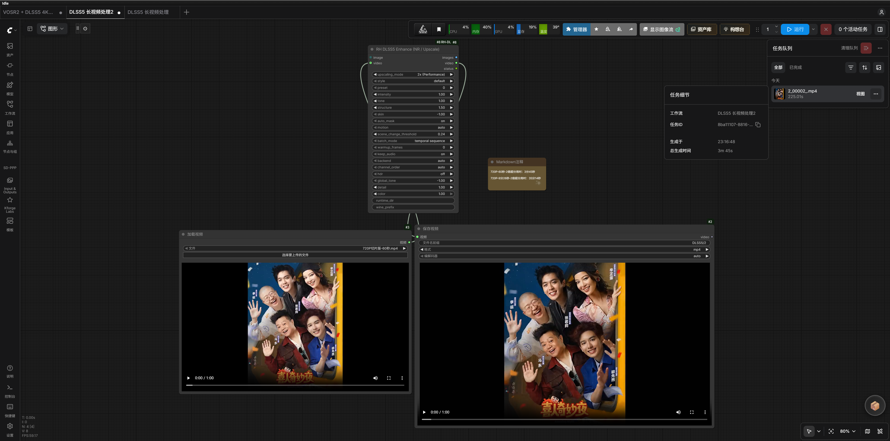
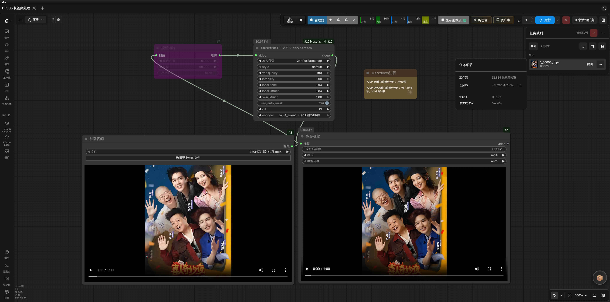

# ComfyUI-Musefish-Nodes

[English](README.md) | **简体中文**

ComfyUI 自定义节点：视频/音频超分、DLSS5 增强、媒体下载、语音识别与音乐母带，另配 [Musefish Studio](studio/README.md) 本地桌面客户端——不打开 ComfyUI 网页端也能跑这些链路。所有注册节点 ID 统一为 `musefish_` 前缀，在画布搜索框输入 `musefish_` 即可列出全部节点；旧版 CamelCase ID 已不再注册。

## 安装

1. 关闭 ComfyUI，在 `ComfyUI/custom_nodes` 目录执行 `git clone https://github.com/Brian98Z/ComfyUI-Musefish-Nodes.git`。没有 Git 就下载仓库 ZIP 解压到该目录并改名，确保 `custom_nodes/ComfyUI-Musefish-Nodes/__init__.py` 存在——多套一层目录会导致插件不被加载。
2. 用**启动这个 ComfyUI 实例的 Python** 安装依赖，不要用系统 Python 或另装一份 PyTorch：

   ```powershell
   & "../python_embeded/python.exe" -m pip install -r "custom_nodes/ComfyUI-Musefish-Nodes/requirements.txt"
   & "../python_embeded/python.exe" -m pip install opencv-python yt-dlp
   ```

   上例是 Windows 便携包结构（`ComfyUI/` 与 `python_embeded/` 同级），请换成启动器实际使用的路径，例如 `../.venv/Scripts/python.exe` 或 Linux 的 `../.venv/bin/python`。若 `import cv2` 已可用，第二条只装 `yt-dlp`；不要混装 OpenCV 的 GUI 与 headless 变体。
3. 重启 ComfyUI，在画布搜索 `musefish_` 确认注册成功。若一个节点都没有，先看启动终端里的插件导入错误——只装依赖不重启不会重新加载节点。

## 节点一览

| 用途 | 节点 ID | 关键参数与约束 | 完整说明 |
| --- | --- | --- | --- |
| PiD 视频超分与后处理 | `musefish_pid_batch_video_upscale`、`musefish_autobatch_antiflicker`、`musefish_autobatch_image_sharpen_fs` | 固定 1024→4096 模型路径；噪声模板跨批复用；去频闪用相邻帧；频率分离锐化带 CPU 卸载。起步 `steps=4`、`sampler=lcm`、`latent_format=flux`；去频闪 `luma_tmp=15`、`chroma_tmp=20`；人像锐化 `hard/gaussian/6`、`amount=0.45`、`noise_threshold=0.01`。接视频合并必须用**后处理后的 IMAGE**，不能用 PiD 的原始 VIDEO 输出 | [PiD](doc/PiD_README.md) |
| DLSS5 图像/流式视频 | `musefish_dlss5_neural_render`、`musefish_dlss5_video_stream` | **仅 RTX 50 系**，专有运行库需自行提供。`Upscale` 决定输出倍率，`vsr_quality` 独立控制 VSR 质量。IMAGE 整批 float32 上限 1 GiB；流式 VIDEO 在宽或高超过 4096 px 时切 HEVC `libx265`/`hevc_nvenc`（CPU `crf=19`、GPU CQ 27）。8K 文件不等于 8K 原生神经渲染细节 | [DLSS5](doc/DLSS5_README.md) |
| 直链下载与断点续传 | `musefish_file_downloader` | 任意 http(s) 直链（CivitAI b2 / S3 / ModelScope / HF）并发分片，按连接限速的 CDN 也能吃满带宽；`.part` + state 文件按同一 URL 续传。`url`（签名参数整串保留）、`save_dir`（留空=`output/musefish`）、`conns`（默认 32，上限 64）、`proxy`（自动=先直连再本机代理）、`overwrite`、`allow_any_dir` / `MUSEFISH_DOWNLOAD_DIRS`。**签名链接对 HEAD 恒返回 401，用 GET 判断有效性** | [文件下载](doc/FILE_DOWNLOAD_README.md) |
| 平台视频下载 | `musefish_video_downloader`、`musefish_wc_video_channels` | YouTube、B站、X、抖音、小红书下载，以及微信视频号本机解密；返回文件支持的 VIDEO 与 FPS。`url`、`platform=Auto`、`quality=best`、`chunks`（支持的平台自动选 8）。YouTube/X 需本地代理，YouTube/抖音可能需要本地 cookies，视频号必须让客户端正在播放目标素材。cookie 文件与含 token 的 URL 属于凭据，不得公开 | [视频下载](doc/VIDEO_DOWNLOAD_README.md) |
| UniverSR 音频超分与母带 | `musefish_universr_model`、`musefish_universr_general_audio`、`musefish_universr_speech_audio` | general 音乐/音效修复、speech 语音增强，素材驱动选档，支持分块推理。模型放在 `ComfyUI/models/UniverSR/models/huggingface/<general\|speech>`，只有 `download=true` 才下载。默认 `auto_params=true`、`input_sr=auto`、`ode_steps=4`、`guidance=1.5`、`chunk_sec=15`、`accel=cuDNN TF32`；显存不足先减小 `chunk_sec`。`stem_mix` 需要两套模型与 Demucs | [UniverSR](doc/UNIVERSR_README.md) |
| 语音识别 | `musefish_asr` | AUDIO 批次转文本：faster-whisper 多语种（CUDA 批处理管线，large-v3-turbo 60 秒 ≈ 7 秒）与 funasr 中文带标点。`engine`、`language`（仅 whisper 生效）、`precision=int8` 减半显存；输出 `text` 与 GPT-SoVITS 兼容的 `.list` 明细。输出节点，可独立运行 | [语音识别](doc/ASR_README.md) |
| 音乐母带 | `musefish_music_mastering` | 本机 PhaseLimiter 引擎：响度统一、真峰限幅、四种算法；驱动与 Studio 工作台共用（`server/mastering.py`）。固定 44.1 kHz 立体声；`loudness_target` 实测误差 <0.1 LU，`ceiling` 默认 −1 dBTP。`level` 仅对 `mastering5` 生效，`matching` 只在 `classic` 下改变输出；优化器随机，比较参数须重复取样。MP3/AAC 恒由引擎 WAV 转码。输出节点：保存到 `output/`，返回 AUDIO + 路径 + 实测响度 | [母带](doc/MASTERING_README.md) |

## 模型与依赖

以下路径都相对你实际启动的 ComfyUI 实例；若启动参数带 `--models-directory`，请把模型与 DLL 放到该根目录下。

- **PiD** —— [PixelDiT UNET/CLIP](https://www.modelscope.cn/models/Comfy-Org/PixelDiT/files) 与 [z_image_turbo VAE](https://www.modelscope.cn/models/Comfy-Org/z_image_turbo/tree/master/split_files/vae)。落盘路径：`ComfyUI/models/diffusion_models/PiD/pid_1.5_flux1_1024_to_4096_4step_int8_convrot.safetensors`、`ComfyUI/models/text_encoders/PixelDiT/gemma_2_2b_it_elm_fp8_scaled.safetensors`、`ComfyUI/models/vae/Flux/UltraFlux-v1-vae.safetensors`（旧版 ComfyUI 可能扫描 `models/unet` 与 `models/clip`）。模板里的视频合并还需 [VideoHelperSuite](https://github.com/Kosinkadink/ComfyUI-VideoHelperSuite)。
- **UniverSR** —— [general](https://huggingface.co/woongzip1/universr-audio/tree/main) 与 [speech](https://huggingface.co/woongzip1/universr-speech/tree/main) 两个模型，各自需要 `config.yaml` 与 `pytorch_model.bin` 两个文件，放在 `ComfyUI/models/UniverSR/models/huggingface/<general|speech>`。`download=true` 时按 `HF_ENDPOINT`（默认 `https://hf-mirror.com`）下载。模板还需 [rgthree-comfy](https://github.com/rgthree/rgthree-comfy) 与 [ComfyUI-Custom-Scripts](https://github.com/pythongosssss/ComfyUI-Custom-Scripts)；`stem_mix` 另需 `demucs` 和两套模型。
- **DLSS5** —— RTX 50 系显卡 + 匹配的 [NVIDIA 驱动](https://www.nvidia.com/Download/index.aspx)。把 `dlssnr_host.dll`、`nvngx_dlssnr.dll`、`vsr_host.dll`、`nvngx_vsr.dll` **直接放进 `ComfyUI/models/dlss5/`**，不要放插件目录；高于 1× 需要后两个 VSR DLL。这些文件不随仓库分发：[用户提供的分享地址](https://pan.quark.cn/s/d4c04dc33d25) **不是 NVIDIA 官方渠道**，使用前自行核对许可与文件名。流式 VIDEO 还要求启动 ComfyUI 的进程 `PATH` 中有 `ffmpeg` 与 `ffprobe`。
- **ASR** —— 模型从 `ComfyUI/models/audio_encoders/faster-whisper` 解析（环境变量 `MUSEFISH_ASR_MODELS` 可覆盖搜索根），与 Musefish Studio 工作台共用；缺失模型首次使用时自动下载。
- **下载链路** —— ComfyUI 的 Python 里装 `yt-dlp`（第 2 步）。微信视频号另依赖仓库自带的 wasm/Node 工具链，且需要本机客户端正在播放目标素材。凭据与代理配置不要提交进仓库。

## 示例工作流

| 工作流 | 使用前检查 |
| --- | --- |
| [PiD 超分与后处理](workflows/Musefish_PiD_Batch_Video_Upscale.json) | 选中自己的 UNET/CLIP/VAE 与输入视频；16 GB 显存从小批次开始 |
| [DLSS5 流式视频](workflows/Musefish_DLSS5_Video_Stream.json) | `LoadVideo → musefish_dlss5_video_stream → SaveVideo`；默认 2× 与 CPU 编码 |
| [UniverSR 音频](workflows/Musefish_UniverSR_Audio.json) | 两条分支，按需启用并替换测试音频；依赖 rgthree 与 ComfyUI-Custom-Scripts |
| [视频下载](workflows/Musefish_Video_Downloader.json) | 无需模型或 RTX 50 显卡；填链接与平台，微信视频号需先在客户端播放目标视频 |

模板中出现的素材名（`抖音热舞.mp4`、`video-2.mp4`、`测试歌曲.mp3`、`测试语音.wav`）只是占位，仓库不附带。

## DLSS5 速度实例：RunningHub 与 Musefish

用户提供的两张 RunningHub 任务截图均为**同一段 720P、60 秒视频，放大 2×**：**RH DLSS5 Enhance (NR / Upscale)** 耗时 **225.01 秒（3 分 45 秒）**，**Musefish DLSS5 Video Stream** 耗时 **80.92 秒（1 分 20 秒）**，约为前者耗时的 **1/2.78**。这只是截图对照，**不是控制变量的节点性能基准**：两者可见增强参数不同，Musefish 侧明确用 GPU H.264 编码，硬件、后端与排队开销无法从截图核实，不要把倍率推广到其他素材或机器。[详细对照说明](doc/DLSS5_README.md#runninghub-与-musefish-任务截图对照)。

| RunningHub 任务 | Musefish 任务 |
| --- | --- |
|  |  |

## 限制

- 16 GB 显存预设是参考值，不保证不 OOM；PiD 长批次仍占主机内存。DLSS5 长视频请用文件流式节点，不要整段塞进一个 IMAGE 批次。
- 单机参考实测：1080P、22 秒视频放大到 8K，GPU HEVC 79 秒、CPU HEVC 300 秒。不是通用速度承诺。
- 第三方模型站的可用性、专有 DLL 的授权不在本仓库控制范围内。

## 客户端与版本

- [Musefish Studio](studio/README.md) 桌面客户端，Windows x64 便携版，**未签名** —— `MusefishStudio-Client-1.9.0-win-x64.exe`，100,159,319 字节，`sha256:4ee43a64…f14893`。运行前用 `SHA256SUMS.txt` 校验，并始终从 [releases/latest](https://github.com/Brian98Z/ComfyUI-Musefish-Nodes/releases/latest) 下载；`Source code (zip/tar.gz)` 是源码归档，不是安装程序。

| 版本 | 要点 |
| --- | --- |
| v1.9.0（2026-11-02） | `musefish_music_mastering` 节点：PhaseLimiter 母带、响度统一、真峰限幅、分阶段进度、最多 4 段并发 |
| v1.8.0（2026-10-26） | `musefish_asr` 节点：faster-whisper 多语种与 funasr 中文，模型与 Studio 共库并支持自动下载 |
| v1.7.0（2026-10-21） | `musefish_file_downloader` 节点；节点 ID 全面改为 `musefish_` 前缀；Studio 与音频链路加固 |
| v1.6.0（2026-10-16） | Musefish Studio 自包含客户端：一键环境准备、模型下载、符号链接模型库 |

更早的变更说明与各版本安装包见 [releases 页面](https://github.com/Brian98Z/ComfyUI-Musefish-Nodes/releases)。
