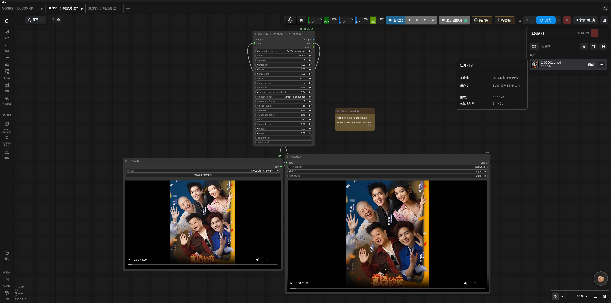
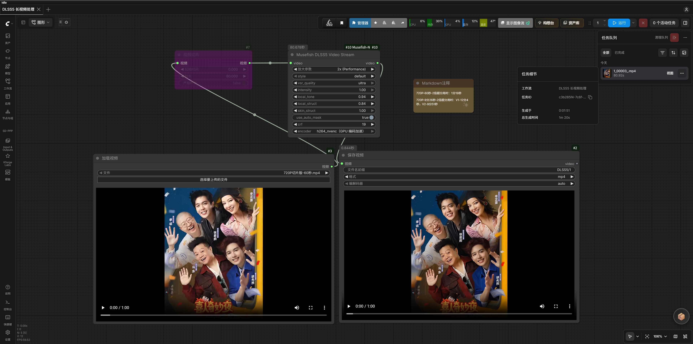

# ComfyUI-Musefish-Nodes

[English](README.md) | **简体中文**

按用途选择节点：PiD 视频超分与后处理、DLSS5 图像/流式视频增强、社交平台视频下载、模型/文件直链下载（并发分片 + 断点续传）、UniverSR 音频超分与母带处理。各链路的模型、参数和显存参考不可混用。安装到 `ComfyUI/custom_nodes/ComfyUI-Musefish-Nodes`，在运行 ComfyUI 的 Python 环境安装所需依赖并重启；依赖细节见各分项说明。

## 新用户从零安装与首次运行

先安装并运行 [ComfyUI](https://docs.comfy.org/get_started)，确认启动所用的 Python 路径。以下路径均以该实例的 `ComfyUI` 目录为起点；不要把依赖装到其他 Python 或覆盖 ComfyUI 自带的 CUDA 版 PyTorch。

1. 关闭 ComfyUI，在 `ComfyUI/custom_nodes` 目录打开终端，执行 `git clone https://github.com/Brian98Z/ComfyUI-Musefish-Nodes.git`。没有 Git 可从仓库 **Code → Download ZIP** 下载解压，并把目录改名为 `ComfyUI-Musefish-Nodes`；最终确认 `custom_nodes/ComfyUI-Musefish-Nodes/__init__.py` 存在，不要多套一层目录。
2. 在 `ComfyUI` 目录，用**启动器实际调用的 Python**安装依赖。若 Windows 便携包目录结构是 `ComfyUI_windows_portable/ComfyUI/` 与同级的 `python_embeded/`，在 `ComfyUI` 目录打开 PowerShell，执行 `& "../python_embeded/python.exe" -m pip install -r "custom_nodes/ComfyUI-Musefish-Nodes/requirements.txt"`，再执行 `& "../python_embeded/python.exe" -m pip install opencv-python yt-dlp`。手动安装/虚拟环境请将 Python 路径替换成启动脚本使用的路径（例如 `../.venv/Scripts/python.exe` 或 Linux 的 `../.venv/bin/python`）；便携包目录并非固定。若 `& "../python_embeded/python.exe" -c "import cv2"` 已成功，则第二条只安装 `yt-dlp`；勿混装 OpenCV GUI/headless 变体，Torch/TorchAudio 沿用 ComfyUI 原环境。
3. 重启 ComfyUI，在画布空白处双击，搜索 **Musefish Video Download**（`Musefish/Video` 分类）。若找不到，先看启动终端中的插件导入错误，检查目录层级和 Python 环境；安装依赖后必须重启。
4. 首次运行无需模型或 RTX 50 显卡：将 [视频下载示例工作流](workflows/Musefish_Video_Downloader.json) 拖入画布（或用 **Workflow → Open**），把可公开访问、你有权下载的 B站视频链接填入 `musefish_video_downloader` 的 `url`，保持 `platform=Auto`、`quality=best`，点击 **Queue Prompt**。示例中下载分支为启用状态，微信视频号分支已跳过。示例含可选的 rgthree 分组切换节点；如果导入时提示缺失，先安装 [rgthree-comfy](https://github.com/rgthree/rgthree-comfy) 并重启，或者手动添加 `Musefish Video Download` 和 `SaveVideo`，将 `video` 输出接到 `video` 输入。成功后可在 `ComfyUI/output/musefish/` 找到下载的 MP4；保存节点另在 `ComfyUI/output/` 生成文件。若网站要求登录或拒绝下载，换合规素材并参考[平台与 cookie 说明](doc/VIDEO_DOWNLOAD_README.md)，不要误判为安装失败。
5. 选择要真正使用的处理链路前，按下表把模型、附加节点和运行库装齐，再导入相应 `workflows/` JSON。模板中的 `抖音热舞.mp4`、`video-2.mp4`、`测试歌曲.mp3`、`测试语音.wav` 只是占位文件名，必须上传自己的素材重新选择；仓库不附带这些文件或模型。

### 模型与依赖下载、落盘清单

所有 `ComfyUI/` 路径均指**实际启动的同一实例**；若使用 `--models-directory`，则把模型/DLL 放到指定的模型根目录下。保留子目录，使模板中的加载器能选中对应文件；装完扩展节点或 DLL 重启 ComfyUI，新模型不显示时刷新浏览器。

| 链路 | 下载入口及附加依赖 | 精确位置与首次验收 |
| --- | --- | --- |
| **PiD 视频超分** | 从 [Comfy-Org PixelDiT](https://www.modelscope.cn/models/Comfy-Org/PixelDiT/files) 下载 PiD UNET 与 PixelDiT CLIP；从 [z_image_turbo VAE](https://www.modelscope.cn/models/Comfy-Org/z_image_turbo/tree/master/split_files/vae) 下载编码 VAE。模板的视频合并还需在 `custom_nodes/` 安装 [VideoHelperSuite](https://github.com/Kosinkadink/ComfyUI-VideoHelperSuite)。 | 分别保存为 `ComfyUI/models/diffusion_models/PiD/pid_1.5_flux1_1024_to_4096_4step_int8_convrot.safetensors`、`ComfyUI/models/text_encoders/PixelDiT/gemma_2_2b_it_elm_fp8_scaled.safetensors`、`ComfyUI/models/vae/Flux/UltraFlux-v1-vae.safetensors`。旧版 ComfyUI 的 UNETLoader/CLIPLoader 可能读取 `models/unet`/`models/clip`，以实际加载器扫描的路径为准。打开 [PiD 模板](workflows/Musefish_PiD_Batch_Video_Upscale.json)，确认三个加载器选中上述文件、LoadVideo 改为自己的视频，初次运行 `frame_load_cap=2`、`batch_size=1`；最终用后处理 IMAGE 合并视频，不要用原始 VIDEO 输出。[详细教程](doc/PiD_README.md)。 |
| **UniverSR 音频超分** | general 模型 [woongzip1/universr-audio](https://huggingface.co/woongzip1/universr-audio/tree/main)、speech 模型 [woongzip1/universr-speech](https://huggingface.co/woongzip1/universr-speech/tree/main)；推荐先用 `Musefish UniverSR Model` 的 `download=true` 自动下载（`HF_ENDPOINT` 默认 `https://hf-mirror.com`），或从每个仓库手动取 `config.yaml` 与 `pytorch_model.bin` 两个文件。模板还需 [rgthree-comfy](https://github.com/rgthree/rgthree-comfy) 和 [ComfyUI-Custom-Scripts](https://github.com/pythongosssss/ComfyUI-Custom-Scripts)；仅 `stem_mix` 需要用 ComfyUI 的 Python 安装 `demucs` 并准备两套模型。 | general 放 `ComfyUI/models/UniverSR/models/huggingface/general/{config.yaml,pytorch_model.bin}`，speech 放同级 `speech/`。打开 [音频模板](workflows/Musefish_UniverSR_Audio.json)，上传自己的音频，先运行默认启用的音乐分支，确认模型缓存连接正确；模型齐备后将 `download=false`。`stem_mix` 的 `model_cache` 必须指向同时包含 general、speech 的 `huggingface/` 父目录。[详细教程](doc/UNIVERSR_README.md)。 |
| **DLSS5 图像/流式视频** | **仅 RTX 50 系**，安装 [NVIDIA 官方驱动](https://www.nvidia.com/Download/index.aspx)。四个专有 DLL 可来自合法获取的 DLSS5Tool，或[用户提供的四文件分享](https://pan.quark.cn/s/d4c04dc33d25)：**非 NVIDIA 官方渠道，下载前自行确认许可和来源**，尚无验证过的官方独立下载地址。VIDEO 流式链路还需从 [FFmpeg 官网](https://ffmpeg.org/download.html) 寻找 Windows 构建、解压后将含 `ffmpeg.exe`/`ffprobe.exe` 的 `bin` 目录加入启动 ComfyUI 的进程 `PATH`。 | 将 `dlssnr_host.dll`、`nvngx_dlssnr.dll`、`vsr_host.dll`、`nvngx_vsr.dll` 直接放在 `ComfyUI/models/dlss5/`，不要放插件目录；>1× 需要后两个 VSR DLL。在启动环境执行 `ffmpeg -version`、`ffprobe -version`，重启 ComfyUI；打开 [流式模板](workflows/Musefish_DLSS5_Video_Stream.json)，替换 LoadVideo 的示例文件，先用短视频测 `2× (Balance)`。无需另装 CUDA Toolkit，不要覆盖 ComfyUI 的 PyTorch。[详细教程](doc/DLSS5_README.md)。 |
| **文件下载（断点续传）** | 纯标准库，无额外依赖（`musefish_fastdl.py`）；签名直链请整串保留参数。 | 无模型文件。留空 `save_dir` 落到 `ComfyUI/output/musefish/`；中断后用相同 url 再跑即续传。见 [文件下载说明](doc/FILE_DOWNLOAD_README.md)。 |
| **通用下载/微信视频号** | 第 2 步已在 ComfyUI 的 Python 安装 `yt-dlp`；微信视频号依赖仓库自带的 WASM/Node 工具链，但需要本机微信客户端正在播放目标素材；部分平台还需自行配置代理/cookie。 | 无模型文件。下载节点接 `SaveVideo` 即可；因站点限制失败时参照[平台、登录和代理说明](doc/VIDEO_DOWNLOAD_README.md)，不要提交 cookie 或含 token 的链接。 |

**故障定位：**加载器找不到权重 → 查实际模型根目录、子文件夹与文件名；工作流节点标红 → 在同一 `custom_nodes/` 安装对应扩展并重启；只有某个下载网址失败 → 查登录/代理/站点限制；DLSS5 VIDEO 报 `ffmpeg and ffprobe must both be available on PATH` → 修复启动器进程的 PATH。第三方下载站的可用性及专有 DLL 的合法授权无法由本仓库保证。

## 按用途选节点

**命名规则**：所有注册节点 ID 统一为 `musefish_` 前缀的 snake_case（显示名统一以 `Musefish` 开头），在画布双击搜索框输入 `musefish_` 即可列出本插件全部节点。脚本、工作流 JSON 和 API 调用请使用下表给出的 ID；旧版 CamelCase ID（如 `MusefishVideoDownload`）已不再注册。

| 用途与节点 | 功能亮点 | 关键参数与注意事项 | 完整说明 |
| --- | --- | --- | --- |
| PiD：`musefish_pid_batch_video_upscale`、`musefish_autobatch_antiflicker`、`musefish_autobatch_image_sharpen_fs` | 固定 1024→4096 的 PiD 路径；逐批复用噪声模板；去频闪带相邻帧上下文；频率分离锐化可分批和 CPU 卸载 | PiD 推荐 `steps=4`、`sampler=lcm`、`latent_format=flux`；去频闪从 `luma_tmp=15/chroma_tmp=20` 起；人像锐化用 `hard/gaussian/6`、`amount=0.45`、`noise_threshold=0.01`。PiD 后处理后的 IMAGE 接视频合并，不能用未经后处理的 VIDEO 输出代替 | [PiD 与后处理](doc/PiD_README.md) |
| DLSS5：`musefish_dlss5_neural_render`、`musefish_dlss5_video_stream` | IMAGE 批次或文件支持 VIDEO 连续增强；已知源分辨率时隐藏不可用倍率；8K 先在 ≤4K 画面增强再插值放大 | **仅 RTX 50 系**；运行库需用户自行提供。`Upscale` 选输出倍率，`vsr_quality` 独立控制 VSR 质量。IMAGE 整批 float32 输出上限 1 GiB；流式 VIDEO 的 CPU/GPU 编码在宽或高超过 4096 时分别切 HEVC `libx265`/`hevc_nvenc`，CPU `crf=19` 默认、GPU CQ 固定 27。8K 文件不等于 8K 原生神经渲染细节 | [DLSS5 安装与参数](doc/DLSS5_README.md) |
| 文件下载：`musefish_file_downloader` | 任意 http(s) 直链（CivitAI b2 / S3 / ModelScope / HF）并发分片下载，按连接限速的 CDN 可吃满带宽；`.part` + state 断点续传，中断后同参重跑即续 | `url`（签名参数整串保留）、`save_dir`（留空=output/musefish）、`conns`（默认 32，最高 64）、`proxy`（自动=先直连再本机代理）、`overwrite`。**HEAD 对签名链接恒 401，用 GET 判断有效性** | [文件下载、续传与代理](doc/FILE_DOWNLOAD_README.md) |
| 视频下载：`musefish_video_downloader`、`musefish_wc_video_channels` | YouTube/B站/X/抖音/小红书下载及微信视频号本机客户端解密；返回文件支持 VIDEO 和 FPS | `url`、`platform=Auto`、`quality=best`、`chunks`（支持的平台可自动吸附 8）；YouTube/X 需本地代理，YouTube/抖音可能需要本地 cookies；视频号需客户端正在播放目标素材。带 token 的 URL 缓存及 cookie 文件均是凭据，不得上传 | [平台、凭据与解密](doc/VIDEO_DOWNLOAD_README.md) |
| 音频：`musefish_universr_model`、`musefish_universr_general_audio`、`musefish_universr_speech_audio` | general 音乐/音效超分与母带、speech 语音增强；素材驱动选档和参数；支持分块处理 | 模型目录 `ComfyUI/models/UniverSR/models/huggingface/<general\|speech>`；`download=true` 才下载。新建节点 `auto_params=true`、`input_sr=auto`、`ode_steps=4`、`guidance=1.5`、`chunk_sec=15`、`accel=cuDNN TF32`；显存不足先减小 `chunk_sec`。`stem_mix` 需要两个模型与 Demucs | [UniverSR 与母带](doc/UNIVERSR_README.md) |

## 安装与模型

- 共用 Python 依赖见 [`requirements.txt`](requirements.txt)；**DLSS5** 还需 ComfyUI 已有 CUDA/PyTorch、OpenCV、RTX 50 系驱动。高于 1× 的模式需额外 VSR 运行库；四个专有 DLL 放在 `ComfyUI/models/dlss5/`，不随仓库分发。[用户提供的分享地址](https://pan.quark.cn/s/d4c04dc33d25) **不是 NVIDIA 官方发行渠道**，下载前核对许可及文件名；详见 [DLSS5 安装说明](doc/DLSS5_README.md#运行依赖与手动部署windows)。VIDEO 流式节点还要求 `ffmpeg`、`ffprobe` 都在 `PATH`；[FFmpeg 下载入口](https://ffmpeg.org/download.html)。
- **PiD UNET/CLIP**：[PixelDiT 模型](https://www.modelscope.cn/models/Comfy-Org/PixelDiT/files)；**VAE**：[z-image/flux1 VAE](https://www.modelscope.cn/models/Comfy-Org/z_image_turbo/tree/master/split_files/vae)。具体文件名及加载器设置见 [PiD 指南](doc/PiD_README.md#节点)。
- **UniverSR** 的 general/speech 模型各需 `config.yaml` 与 `pytorch_model.bin`；模型节点仅在 `download=true` 时按 `HF_ENDPOINT`（默认 `https://hf-mirror.com`）下载。[缓存与模式说明](doc/UNIVERSR_README.md)。
- 下载平台依赖 yt-dlp；微信视频号另需本机客户端及插件自带的 wasm/Node 解密工具。代理、cookie、安全边界见 [下载说明](doc/VIDEO_DOWNLOAD_README.md)。

## 示例工作流

| 工作流 | 入口与使用前检查 |
| --- | --- |
| [PiD 超分与后处理](workflows/Musefish_PiD_Batch_Video_Upscale.json) | 提供 UNET/CLIP/VAE 和输入视频；16GB 显存从小批次开始 |
| [DLSS5 流式视频](workflows/Musefish_DLSS5_Video_Stream.json) | `LoadVideo → musefish_dlss5_video_stream → SaveVideo`；先选自己的输入文件；默认 2×、CPU 编码 |
| [UniverSR 音频/语音](workflows/Musefish_UniverSR_Audio.json) | 16GB 参考，两条分支，使用前选择自己的音频和启用对应分支；额外依赖 rgthree、ComfyUI-Custom-Scripts |
| [视频下载](workflows/Musefish_Video_Downloader.json) | 配置分享链接/平台；视频号需先打开客户端并播放目标视频 |

## DLSS5 速度实例：RunningHub 与 Musefish

用户提供的两张 RunningHub 任务截图均标注**同一段 720P、60 秒视频，放大 2×**：**RH DLSS5 Enhance (NR / Upscale)** 耗时 **225.01 秒（3 分 45 秒）**，**Musefish DLSS5 Video Stream** 耗时 **80.92 秒（1 分 20 秒）**；该任务截图中的完成时间约为前者的 **1/2.78**。这是实际任务展示，**不是严格控制变量的节点性能基准**：两者可见增强参数不一致，Musefish 截图明确选用 GPU H.264 编码，截图也不足以核实硬件、后端与排队开销完全相同；不应将倍率推广至其他视频或机器。[详细对照说明](doc/DLSS5_README.md#runninghub-与-musefish-任务截图对照)。

| RunningHub 任务 | Musefish 任务 |
| --- | --- |
|  |  |

## 注意与版本

- PiD/UniverSR 模板中的 16GB 设置是参考值，不保证所有素材不 OOM；PiD 长视频仍占 CPU 内存。DLSS5 长视频应优先用流式 VIDEO 而非整段 IMAGE 批次。
- 同一段 1080P、22 秒视频放大到 8K：**用户实测 GPU HEVC 79 秒、CPU HEVC 300 秒**；仅作为该素材和设备的对照，非通用速度承诺。[详细质量与编码说明](doc/DLSS5_README.md)。
- **v1.7.0（2026-10-21）：** 新增 `MusefishFileDownload` 节点（ID `musefish_file_downloader`）——直链/签名 CDN 并发分片下载 + 断点续传，与 Studio 的「文件断点续传」共用 `musefish_fastdl.py`；全部节点 ID 统一为 `musefish_` 前缀。分项要点：
  - **下载器：** 分片级持久检查点、外层重试、重定向跳数上限、连接复用池、续传按远端对象 ETag/大小绑定（签名更新才换 URL）、无 `Content-Length` 时单流兜底、进度不重复计数、保存目录白名单（`allow_any_dir` 需显式开启，另可用 `MUSEFISH_DOWNLOAD_DIRS`）、本机代理自动探测、支持 ComfyUI 取消。
  - **Studio：** 写操作必须带 `X-Musefish-Client: 1`；`/files/` 路径解析后必须落在 output 目录内，非媒体类型按附件返回并加 `nosniff`；恢复任务时校验 id 并清洗产物 URL；`jobs.json` 写入串行化，关停前 join 写线程再做最终落盘。
  - **音频：** 批处理监督协议（start/progress/result/error 有序，缺失产物即失败，退出后 stdout 读到 EOF）、BS.1770 K 加权响度、重叠淡出、单声道母带、UniverSR 频带修复。
  - **DLSS5 / 视频：** alpha 原地合成、worker 事件读取可超时、分段下载逐段落盘并校验区间与 Cookie、站点解析失败时自动升级 yt-dlp 并重试一次（6 小时内只尝试一次）。
  - **测试：** fastdl 加固/重定向/连接复用、下载进度、Studio 任务持久化、音频批处理。
- **v1.6.0（2026-10-16）**：[Musefish Studio](studio/README.md) 自包含本地客户端模式——一键环境准备（`studio/tools/env_setup.py`：venv + pin ComfyUI v0.39.0 内核 + 两阶段 pip）、ModelScope/HuggingFace 模型下载、模型符号链接映射、server 托管 headless 引擎、Windows 客户端（含模型就绪状态显示）。[GitHub v1.6.0 Release](https://github.com/Brian98Z/ComfyUI-Musefish-Nodes/releases/tag/v1.6.0) 提供 `MusefishStudio-Client-1.6.0-win-x64.exe` 客户端与 `SHA256SUMS.txt` 校验清单。
- **v1.5.0（2026-09-28）**：DLSS5 英文 Upscale、源分辨率选项过滤、8K 稳定增强、CPU HEVC 与新流式模板。历次版本说明及验证数据见各分项文档；[GitHub v1.5.0 Release](https://github.com/Brian98Z/ComfyUI-Musefish-Nodes/releases/tag/v1.5.0)。
