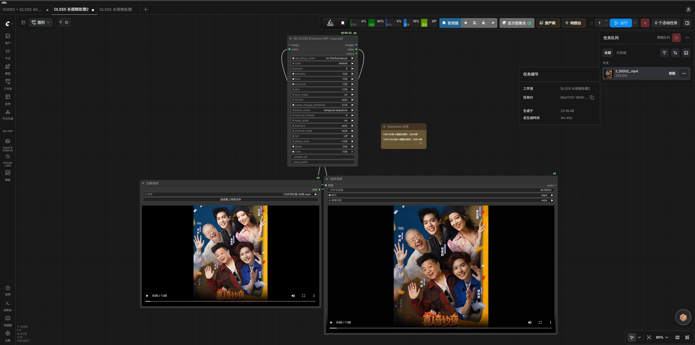
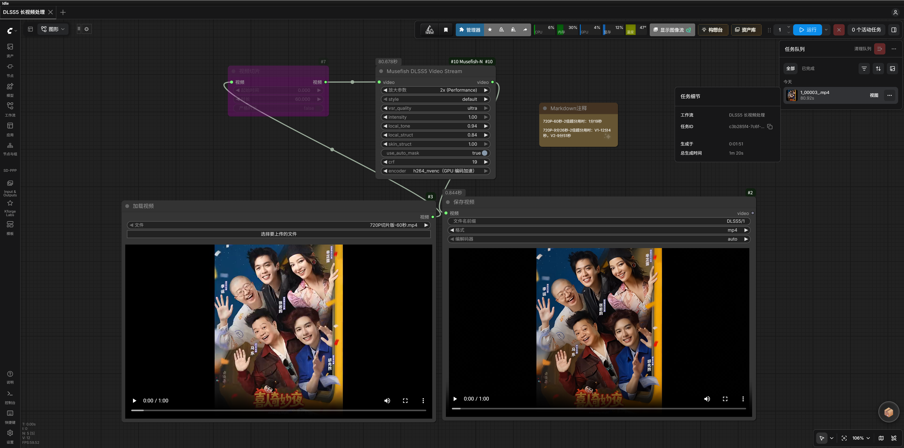

# Musefish DLSS5 Upscaling Nodes

> **NVIDIA RTX 50 Series (Blackwell) only.** Requires a driver with NGX/D3D12 support; RTX 40 Series and earlier cannot create Feature 18. Verified: RTX 5070 Ti + driver 616.56. ComfyUI Python must see CUDA. No separate CUDA Toolkit is required; do not replace ComfyUI's CUDA PyTorch.

## Nodes and setup

- `musefish_dlss5_neural_render` (Musefish DLSS5 Neural Render): single images/short-video IMAGE batches; fixed to one worker.
- `musefish_dlss5_video_stream` (Musefish DLSS5 Video Stream): frame-by-frame file-backed VIDEO, for high-resolution and long videos. Both are in `Musefish/Video`.
- Put the four external DLLs in `dlss5/` under the active models directory: default `ComfyUI/models/dlss5/`; with `--models-directory`, use its `dlss5/` subdirectory, not the plugin's `dlss5_backend/dlls/`.

| Filename | Purpose |
|---|---|
| `dlssnr_host.dll` | Feature 18 host; current code uses the legacy host |
| `nvngx_dlssnr.dll` | Feature 18 NGX runtime |
| `vsr_host.dll` | RTX Video Super Resolution host; used above 1× |
| `nvngx_vsr.dll` | VSR NGX runtime |

User-provided four-file share: <https://pan.quark.cn/s/d4c04dc33d25>. This cloud-drive link is **not an official NVIDIA or DLSS5Tool distribution URL**; verify permission to obtain and use the files, and avoid unknown mirrors. The same files can be extracted from a legitimately obtained DLSS5Tool `_internal/` directory. No official standalone download URL for the four private runtimes has been verified. The public [NVIDIA DLSS SDK](https://github.com/NVIDIA/DLSS) is not a substitute for these hosts and runtimes. The node does not read `models/dlss5/nvngx_dlss.dll` or `models/dlss5/caller/`; these may belong to the RH-DLSS5 plugin. Restart ComfyUI after setup.

Driver: [official NVIDIA driver page](https://www.nvidia.com/Download/index.aspx). The worker looks for `cudart64_*.dll` in ComfyUI PyTorch to accelerate pinned shared-memory registration; if unavailable, it falls back to pageable memory without preventing processing.

### Dependencies

Both nodes use ComfyUI PyTorch/CUDA, `numpy`, and `cv2`. `requirements.txt` includes NumPy but not OpenCV; if `cv2` is missing, install `opencv-python` in ComfyUI's Python environment, not both GUI and headless OpenCV packages. Only VIDEO also requires `ffmpeg` and `ffprobe` discoverable on the launching ComfyUI process's `PATH`; IMAGE does not invoke FFmpeg. Windows builds: [FFmpeg download page](https://ffmpeg.org/download.html). It links third-party providers; follow the selected build's license and distribution terms.

## Parameters and sizing

| Parameter | Meaning / values |
|---|---|
| `style` | `default/natural/cinema` |
| `intensity`, `local_tone`, `local_struct`, `skin_struct` | Each `0–1` |
| `use_auto_mask` | Skin-mask toggle |
| `reset_every_n_frames` | `0` = reset only on chunk's first frame (continuous session); `1` = independent per frame (old behavior); N>0 resets in place by frame index, without recreating the session. Experimental values outside `[0,1]` are clamped. |
| `Upscale` (IMAGE/VIDEO; input ID `super_resolution`) | `off`, `1× (Native)`, `1.5× (Quality)`, `2× (Balance)`, `3× (Performance)`, `4× (Ultra)`, `1K`, `2K`, `4K`, `8K`. 1× does not upscale; 2×/4× use native VSR; 1.5×/3× are synthesized by downscaling 2×/4× VSR. K modes choose the smallest achievable multiplier for a short-edge target of 1080/1440/2160/4320; output and VSR intermediate images are limited to 7680×4320 pixels. 720p→4K uses a 5120×2880 intermediate, downscaled to 3840×2160. Known source sizes hide unavailable multipliers: VIDEO (optionally through Video Slice) is probed with ffprobe; LoadImage size is read directly. Other IMAGE sources are checked at runtime. IMAGE/VIDEO 1080p→8K first enhance a frame no larger than 4K, then interpolate to 8K. IMAGE float32 output batches are capped at 1 GiB; excess is rejected and VIDEO is recommended. |
| `vsr_quality` | `performance/balanced/quality/ultra`; VSR's NGX PerfQuality 1–4; `ultra` is DLSS5Tool's default. Unlike `Upscale`, it selects VSR quality, not output size. |
| `keep_session` | `auto/off`; auto reuses a warm worker across batches of one task and closes/releases VRAM about 2–3 seconds after completion/interruption; off closes after each execution. |
| `parallel_workers` | Removed from IMAGE and fixed to one worker; use streaming for long video. |

## Streaming VIDEO

Connect `LoadVideo (VIDEO) → musefish_dlss5_video_stream (VIDEO) → SaveVideo`. A run uses one NGX session, two RGBA8 shared-memory slots, and a single-frame decode/encode buffer, not an IMAGE batch; temporal history is continuous. The intermediate filename is fixed as `Musefish/DLSS5_stream_<random-value>.mp4`; set the final name only in SaveVideo's `filename_prefix`. Original audio is converted to AAC. When both width and height are ≤4096, H.264 is used; CPU defaults to adjustable `crf=19`. `encoder` defaults to `libx264`; CPU switches to HEVC `libx265` when either output dimension exceeds 4096, with quality controlled by `crf`. Optional `h264_nvenc` uses fixed GPU CQ 27 (not equivalent in quality to CRF 19); GPU output switches to HEVC `hevc_nvenc` when either dimension exceeds 4096 (MP4 `hvc1`, CQ 27). CPU 8K uses HEVC `libx265` (MP4 `hvc1`, controlled by `crf`). On failure/interruption, incomplete `.part.mp4` files are removed and the worker is closed.

> **An 8K file does not mean native 8K neural-rendered detail.** Direct 8K neural rendering showed color shifts and background noise in real footage, so enhancement runs on an intermediate no larger than 4K, followed by interpolation; IMAGE works the same way and has no video encoder. Maximum individual frame/intermediate image: 7680×4320. With the GPU dedicated, 1080p `off` is about 21ms/frame and 2× to 4K about 70ms/frame; pinned memory measured 1080p `off` at 23.0ms→21.1ms/frame (about +8%). Missing CUDA runtime falls back without functional impact. HDR RGBA16F/PQ/HLG is not wrapped; only SDR RGBA8 is supported.

Use the streaming node for long videos. Upstream `VHS_LoadVideo` loads the whole video if `frame_load_cap` is unset; use `frame_load_cap`/`skip_first_frames` to split long videos. VIDEO is returned only after dimensions, frame rate, and frame count are checked; nominal and average frame rates may differ slightly. Video Slice windows are applied to decoding and original audio with the same start/duration and a bounded frame count. The old version ignored the window; a 60-second slice once processed the full 566.5 seconds. Progress is based on frames written to the encoder, capped at 99% until muxing/validation finish, and reaches 100% only after output succeeds; it excludes downstream SaveVideo.

### Encoding measurements

For 1280×720@30fps input, 2× upscale, continuous 60 seconds (1800 frames): end-to-end time 74.1s→65.1s; intermediate MP4 95.5MB→99.1MB. In a separate user-provided end-to-end test, the same 1080p, 22-second video upscaled to 8K took 79s with GPU HEVC and 300s with CPU HEVC (about 3.8×). This is not the 720p/2× benchmark and does not predict other footage or hardware. Verified outputs: 720p→4K 3840×2160, landscape 1080p→8K 7680×4320, portrait 1080p→8K 4320×7680; all include AAC audio.

## Performance and temporal behavior

2026-09-23 baseline: i5-14600K + RTX 5070 Ti; 801 frames at 480×848, 2× VSR + Feature 18 ultra, `LoadVideo → DLSS5 → VideoCombine`. Before/after: node 29.76s/16.75s (1.78×), full pipeline 70.81s/53.31s, GPU utilization 22–26%/25–49%, main-process CPU about 12.5–13.4/1.5–2.2 cores, per-frame conversion 330–380/about 30 CPU-ms. NumPy conversion and double buffering reduce overhead; with GPU saturated at about 99%, both paths were around 43–46fps. On 120 frames at 480×848→960×1696 with two warm-session workers, low-utilization old/new paths ran at 61.5–65.9/75.2–94.1fps; conversion microbenchmark was 16.7→2.8 CPU-ms/frame, with bit-identical output.

IMAGE is fixed to one worker. Historical 480p parallel tests: 1/2/4/8/16/32 workers took 31/23/39/40/41/176s at 17/21/31/49/85/99% VRAM. 720p long-video runs took 159–168s with 1–8 workers; 16 workers took 233s/98% VRAM and 32 ran out of memory. More free VRAM does not guarantee equivalent temporal results at higher concurrency. The old version reset history every frame; default `reset_every_n_frames=0` now preserves within-chunk history. On the same source, about 7% of pixels changed by >8/255; mean abs diff was about 3.4/255. Set it to 1 for bit-for-bit old behavior (verified with workers=1/2).

The NGX host runs in an isolated child process; the ComfyUI main process never loads NVIDIA DLLs. Frames use shared memory. `keep_session=auto` reuses only pools with an exact matching contract; parameter changes close the old pool. Workers close after 2 seconds idle, but remain warm across VHS Meta Batch continuation. Peak node memory is about the upstream input batch plus output batch.

## Verification record

**2026-09-24 conversion optimization:** interleaved A/B, 120 frames at 480×848→960×1696, two workers/warm sessions: old/new paths 61.5–65.9/75.2–94.1fps at low utilization; both 43–46fps with GPU saturated at about 99%. Bit-identical output; conversion microbenchmark 16.7→2.8 CPU-ms/frame.

**2026-09-23 regression baseline:** i5-14600K + RTX 5070 Ti, 801 frames at 480×848, 2× VSR + Feature 18 ultra, `LoadVideo → DLSS5 → VideoCombine`. Node 29.76s→16.75s (1.78×), full pipeline 70.81s→53.31s; GPU 22–26%→25–49%, main-process CPU about 12.5–13.4→1.5–2.2 cores; conversion 330–380→about 30 CPU-ms/frame.

Historical parallel tests: 480p at 1/2/4/8/16/32 workers took 31/23/39/40/41/176s, using 17/21/31/49/85/99% VRAM; 720p took 159–168s at 1–8 workers, 233s/98% at 16, and OOM at 32. On 400 frames, K=1/2/3 throughput was 18.2/22.4/23.8fps with 20%/36%/42% GPU; K=4 fell to 12.0fps due to VRAM/scheduling overhead, so the limit is 3.

Old behavior reset history per frame; default 0 now preserves it. On the same source, about 7% of pixels changed by >8/255 (mean abs diff about 3.4/255); setting 1 reproduces old output bit-for-bit, verified with workers=1/2. Shared-memory conversion matched input bytes for 60/60 frames; boundary cases 0.5/255, 2.5/255, negative, >1 matched, and float32 output was bit-identical. Two-deep pipeline and continuous chunks with 2/3 workers matched on 72/20-frame real clips.

8988 end-to-end `LoadVideo → DLSS5(workers=2) → VideoCombine`: `output/Musefish/DLSS5_video_00015.mp4`; node 16.75s (old 29.76s), full pipeline 53.31s (old 70.81s), GPU 25–49%, main-process CPU about 1.5–2.2 cores (old about 13). With the same contract, cached second execution took 5.52s→2.95s (2 workers), with identical output.

**2026-09-20 output validation:** `LoadImage → musefish_dlss5_neural_render → SaveImage` produced `output/dlss5_test_00001_.png`; 54.4% of pixels changed by >8/255; mean abs diff 8.18. 2× RTX VSR + Feature 18 produced 1728×2304 (`output/dlss5_sr2x_00001_.png`); all four VSR presets passed. Shared-memory outputs `shm_off_00001_.png`/`shm_2x_00001_.png` measured 864×1152/1728×2304; dedicated-GPU off at 1080p was about 18.5ms/frame, 2× to 4K about 70ms/frame. 1.5× converted 864×1152 to 1296×1728; two runs took 2.3s→1.0s; offline warm-session first frame 34ms vs 1271ms cold (37×).

On RTX 5070 Ti + 616.56, the first `dlssnr_process` call in the v2 worker did not return (suspected NVIDIA App overlay NGX conflict); the legacy `dlssnr_host.dll` used here worked at about 4ms/frame at 256px. Pinned shared memory measured 1080p off steady state at 23.0ms→21.1ms/frame (about +8%). Embedded-Python pytest with `--import-mode=importlib`: 39 passed / 4 subtests; three session open/close cycles had no leaks; 1080p→2x with `keep_session=auto` repeatedly produced output.

## Comparison and example

Two user-provided RunningHub screenshots show `720P切片版-60秒.mp4` (about one minute), upscaled 2×. **RH DLSS5 Enhance (NR / Upscale)** shows 225.01 seconds (3m 45s); **Musefish DLSS5 Video Stream** shows 80.92 seconds (1m 20s); displayed-time ratio: 225.01 / 80.92 ≈ 2.78. This is an end-to-end task screenshot comparison, not proof of a 2.78× faster engine: visible enhancement settings differ, Musefish uses GPU H.264, and screenshots cannot establish identical hardware, queue time, encoding, or quality.

## Related files

- Recommended workflow: `workflows/Musefish_DLSS5_Video_Stream.json` (defaults to 2×/CPU encoding).
- Example: [`assets/DLSS5超分案例.mp4`](../assets/DLSS5超分案例.mp4) (1472×1280@24fps, 10 seconds; 2× RTX VSR + Feature 18).
- [RunningHub versus Musefish task snapshot](#runninghub-versus-musefish-task-snapshot)

## RunningHub versus Musefish task snapshot

| RH task screenshot | Musefish task screenshot |
|---|---|
|  |  |
