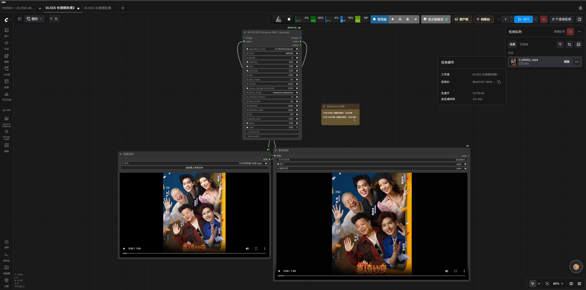
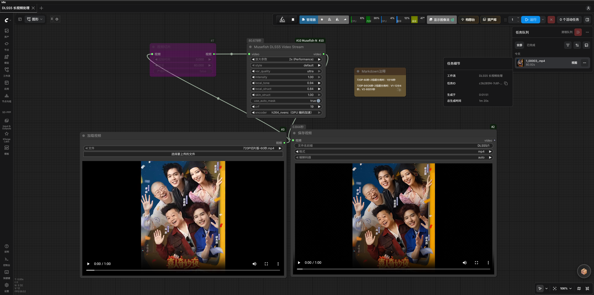

# Musefish DLSS5 超分节点

> **仅 NVIDIA RTX 50 系（Blackwell）**：需支持 NGX/D3D12 的驱动；40 系及更早无法创建 Feature 18。已验证 RTX 5070 Ti + 616.56。节点需 ComfyUI Python 可见 CUDA；无需另装 CUDA Toolkit，也勿替换 ComfyUI 的 CUDA PyTorch。

## 节点与部署

- `musefish_dlss5_neural_render`（Musefish DLSS5 Neural Render）：单图/短视频 IMAGE 帧批次，固定单 worker。
- `musefish_dlss5_video_stream`（Musefish DLSS5 Video Stream）：文件支持 VIDEO 逐帧增强，适合高清、长视频。均属 `Musefish/Video`。
- 将四个外部 DLL 放在当前模型目录的 `dlss5/`：默认 `ComfyUI/models/dlss5/`；`--models-directory` 指定时放在其下的 `dlss5/`，不是插件 `dlss5_backend/dlls/`。

| 文件 | 用途 |
|---|---|
| `dlssnr_host.dll` | Feature 18 宿主；当前使用 legacy 宿主 |
| `nvngx_dlssnr.dll` | Feature 18 NGX runtime |
| `vsr_host.dll` | RTX Video Super Resolution 宿主；倍率高于 1× 时使用 |
| `nvngx_vsr.dll` | VSR NGX runtime |

四文件用户分享：<https://pan.quark.cn/s/d4c04dc33d25>。此为用户云盘链接，**不是 NVIDIA 或 DLSS5Tool 官方发行地址**；请自行确认取得和使用许可，勿从不明镜像下载。也可从合法取得的 DLSS5Tool `_internal/` 提取；尚未核实四个私有运行库的官方独立下载 URL。公共 [NVIDIA DLSS SDK](https://github.com/NVIDIA/DLSS) 不能替代宿主与运行时。节点不读取 `models/dlss5/nvngx_dlss.dll` 或 `models/dlss5/caller/`，它们可能属于 RH-DLSS5 插件。安装后重启 ComfyUI。

驱动：[NVIDIA 官方驱动页](https://www.nvidia.com/Download/index.aspx)。worker 尝试从 ComfyUI PyTorch 定位 `cudart64_*.dll`，仅加速共享内存 pinned 注册；不可用时回退 pageable 内存，功能仍可用。

### 依赖

IMAGE/VIDEO 共用 ComfyUI PyTorch/CUDA、`numpy`、`cv2`；`requirements.txt` 有 NumPy、无 OpenCV，缺少 `cv2` 时在 ComfyUI Python 安装 `opencv-python`，勿同时装 GUI 与 headless 包。仅 VIDEO 另需 `ffmpeg`、`ffprobe` 均可从启动 ComfyUI 的 `PATH` 找到；IMAGE 不调用 FFmpeg。Windows 构建见 [FFmpeg 下载页](https://ffmpeg.org/download.html)，该页链接第三方构建，遵守其许可条款。

## 参数与尺寸

| 参数 | 语义/取值 |
|---|---|
| `style` | `default/natural/cinema` |
| `intensity`、`local_tone`、`local_struct`、`skin_struct` | 各 `0–1` |
| `use_auto_mask` | 皮肤蒙版开关 |
| `reset_every_n_frames` | `0`=块首重置、会话内连续；`1`=逐帧独立（旧行为）；N>0 按帧号在引擎内重置、不重建会话；旧实验范围外值夹紧到 `[0,1]` |
| `Upscale`（IMAGE/VIDEO；输入 ID `super_resolution`） | `off`、`1× (Native)`、`1.5× (Quality)`、`2× (Balance)`、`3× (Performance)`、`4× (Ultra)`、`1K`、`2K`、`4K`、`8K`。1× 不放大；2×/4× 原生 VSR；1.5×/3× 分别由 2×/4× VSR 缩小合成。K 档按短边目标 1080/1440/2160/4320 选最小可达倍率；输出和 VSR 中间图限 7680×4320 像素。720p→4K 用 5120×2880 中间图缩至 3840×2160。已知源尺寸时隐藏超限倍率；VIDEO（可经 Video Slice）用 ffprobe，LoadImage 直接读尺寸；其他 IMAGE 来源执行时校验。1080p→8K 的 IMAGE/VIDEO 均先在不超过 4K 的画面神经增强，再插值放大。IMAGE 整批 float32 输出上限 1 GiB，超限拒绝并建议 VIDEO。 |
| `vsr_quality` | `performance/balanced/quality/ultra`；VSR 的 NGX PerfQuality 1–4，`ultra` 为 DLSS5Tool 默认。与选输出尺寸的 `Upscale` **语义不同、彼此独立**。 |
| `keep_session` | `auto/off`；auto 同任务分批复用热 worker，结束/中断约 2–3 秒后关闭释放显存；off 每次执行后关闭。 |
| `parallel_workers` | IMAGE 控件已移除并固定 1 路；长视频用流式节点。 |

## 流式 VIDEO

连接 `LoadVideo (VIDEO) → musefish_dlss5_video_stream (VIDEO) → SaveVideo`。一次运行用一个 NGX 会话、两个 RGBA8 共享内存槽及单帧编解码缓冲，不创建整批 IMAGE 帧；时序历史连续。中间文件名固定 `Musefish/DLSS5_stream_<随机值>.mp4`；最终文件名只由 SaveVideo 的 `filename_prefix` 决定。原音频转 AAC；宽、高均≤4096 使用 H.264，CPU 默认 `crf=19`（可调）。`encoder` 默认 `libx264`；宽或高>4096 时 CPU 自动切 `libx265`（HEVC），CPU `crf` 控制画质。可选 `h264_nvenc`，GPU 固定 CQ 27（与 CRF 19 画质不等价）；GPU 输出宽或高>4096 自动切 `hevc_nvenc`（HEVC，MP4 `hvc1`，CQ 27）。CPU 8K 用 HEVC `libx265`（MP4 `hvc1`，按 `crf`）。失败/中断会清理未完成 `.part.mp4` 并关闭 worker。

> **8K 不代表原生 8K 神经渲染细节。** 实片直接 8K 神经渲染出现偏色、背景噪点，故最多在 4K 中间画面神经增强，再插值放大；IMAGE 同样如此，且没有视频编码器。最大单帧/中间图为 7680×4320。GPU 独占时 1080p `off` 约 21ms/帧、2×至 4K 约 70ms/帧；1080p `off` pinned 内存实测 23.0ms→21.1ms/帧（约+8%），缺 CUDA runtime 回退不影响功能。HDR RGBA16F/PQ/HLG 未封装，仅 SDR RGBA8。

长视频请用流式节点。上游 `VHS_LoadVideo` 未设 `frame_load_cap` 会整段载入内存，长视频配合 `frame_load_cap`/`skip_first_frames` 分段。VIDEO 返回前验证尺寸、帧率、帧数；名义帧率与平均帧率可能略异。可接 Video Slice，解码和音频共用裁剪起点、时长并限制帧数；旧版忽略窗口，60 秒切片曾处理完整 566.5 秒原片。进度按已写入编码器帧数，封装验证前至多 99%，成功后 100%，不含下游 SaveVideo。

### 编码实测

1280×720@30fps、2×、连续 60 秒（1800 帧）：整链 74.1s→65.1s，内层 MP4 95.5MB→99.1MB。另一组同一 1080p、22 秒视频放大至 8K：GPU HEVC 79s、CPU HEVC 300s（约3.8倍）；用户提供的整链结果，不是上述 720p 基准，不能推断其他素材/硬件。已验证 720p→4K 3840×2160、横屏 1080p→8K 7680×4320、竖屏 1080p→8K 4320×7680，均含 AAC。

## 性能与时序

2026-09-23 基线：i5-14600K + RTX 5070 Ti，480×848、801 帧，2× VSR + Feature 18 ultra，`LoadVideo → DLSS5 → VideoCombine`。优化前/后：节点 29.76s/16.75s（1.78×），整链 70.81s/53.31s，GPU 利用率 22–26%/25–49%，主进程 CPU 约12.5–13.4/1.5–2.2 核，逐帧转换 330–380/约30 CPU-ms。NumPy 转换与双缓冲重叠减少开销；GPU 饱和约99%时新旧均约43–46fps。120帧 480×848→960×1696、2 worker 热会话：低占用旧路径 61.5–65.9fps、新路径75.2–94.1fps；转换微基准 16.7→2.8 CPU-ms/帧，输出逐比特一致。

IMAGE 固定单 worker。旧 480p 并行实测：1/2/4/8/16/32 路耗时 31/23/39/40/41/176s，显存17/21/31/49/85/99%；720p 长视频 1–8 路159–168s，16路233s/98%，32路 OOM。不可因空闲显存增加并发并假设时序结果相同。旧版每帧重置历史；现默认 `reset_every_n_frames=0` 保留块内时序，同素材约7%像素变化>8/255，mean abs diff约3.4/255。需旧版逐比特结果时设为1（workers=1/2 已验证）。

节点在隔离子进程加载 NVIDIA DLL，主进程不加载；帧经共享内存传输，worker 侧处理。`keep_session=auto` 仅复用契约完全相同的池，参数变化会关闭旧池；空闲2秒后关闭，VHS Meta Batch 续批期间保留。峰值内存约为上游输入批次+输出批次。

## 验证记录

**2026-09-24 转换优化**：480×848→960×1696，120帧、2 workers、热会话交错 A/B；低占用旧路径 61.5–65.9fps，新路径 75.2–94.1fps；GPU 饱和约99%时新旧均43–46fps。输出逐比特一致；转换微基准 16.7→2.8 CPU-ms/帧。

**2026-09-23 回归基线**：480×848、801帧，i5-14600K + RTX 5070 Ti，2× VSR + Feature 18 ultra，`LoadVideo → DLSS5 → VideoCombine`。节点 29.76s→16.75s（1.78×），整链70.81s→53.31s；GPU 22–26%→25–49%，主进程 CPU约12.5–13.4核→1.5–2.2核；转换330–380→约30 CPU-ms/帧。

旧并行实测：480p 1/2/4/8/16/32 worker 分别31/23/39/40/41/176s，显存17/21/31/49/85/99%；720p 1–8路159–168s，16路233s/98%，32路 OOM。400帧扫描 K=1/2/3 吞吐18.2/22.4/23.8fps、GPU20%/36%/42%；K=4因显存/调度降至12.0fps，上限设3。

时序旧版逐帧 reset；默认0现保留历史，同素材约7%像素变化>8/255，mean abs diff约3.4/255；设1可复现旧版逐比特结果，workers=1/2 均通过。共享内存转换输入字节60/60帧一致；边界0.5/255、2.5/255、负数、>1 一致，float32输出逐比特一致。2深度流水线和连续分块2/3 workers 对72/20帧真机素材逐比特一致。

8988端到端 `LoadVideo → DLSS5(workers=2) → VideoCombine`：`output/Musefish/DLSS5_video_00015.mp4`；节点16.75s（旧29.76s）、整链53.31s（旧70.81s），GPU25–49%、主进程CPU约1.5–2.2核（旧约13核）。会话缓存同契约第二次执行5.52s→2.95s（2 workers），输出一致。

**2026-09-20 输出验证**：`LoadImage → musefish_dlss5_neural_render → SaveImage` 输出 `output/dlss5_test_00001_.png`；54.4%像素变化>8/255，mean abs diff 8.18。2× RTX VSR + Feature 18 输出1728×2304（`output/dlss5_sr2x_00001_.png`），四个VSR质量档通过。共享内存 `shm_off_00001_.png`/`shm_2x_00001_.png` 尺寸864×1152/1728×2304；GPU独占时 off 1080p约18.5ms/帧、2×至4K约70ms/帧。1.5×将864×1152变为1296×1728；连续执行2.3s→1.0s；离线热会话首帧34ms、冷启动1271ms（37×）。

隔离worker v2实测首次 `dlssnr_process` 不返回（RTX 5070 Ti + 616.56，疑似 NVIDIA App overlay NGX 冲突）；使用的 legacy `dlssnr_host.dll` 正常，256px约4ms/帧。pinned共享内存1080p off稳态23.0ms→21.1ms/帧（约+8%）。嵌入式 Python pytest `--import-mode=importlib`：39 passed / 4 subtests；开关会话3轮无泄漏；1080p→2x、`keep_session=auto` 连续出片。

## 对照与案例

用户提供的 RunningHub 两张截图均为 `720P切片版-60秒.mp4`、约1分钟、2×：**RH DLSS5 Enhance (NR / Upscale)** 225.01 秒（3分45秒），**Musefish DLSS5 Video Stream** 80.92 秒（1分20秒），显示耗时比 225.01 / 80.92 ≈ 2.78。仅为整任务截图对照，不证明引擎快2.78倍；增强参数可见差异，Musefish 使用 GPU H.264，截图不能确认硬件、队列、编码和画质相同。

## 相关文件

- 推荐工作流：`workflows/Musefish_DLSS5_Video_Stream.json`（默认2×/CPU编码）。
- 案例：[`assets/DLSS5超分案例.mp4`](../assets/DLSS5超分案例.mp4)（1472×1280@24fps，10秒；2× RTX VSR + Feature 18）。
- [RunningHub 与 Musefish 任务截图对照](#runninghub-versus-musefish-task-snapshot)

## RunningHub 与 Musefish 任务截图对照

| RH 任务截图 | Musefish 任务截图 |
|---|---|
|  |  |
