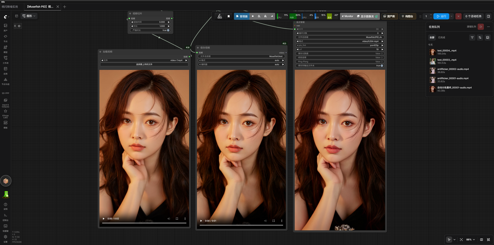

# PiD Video Upscaling and Postprocessing

## Quick Start

Pipeline: `Musefish PiD Batch Video Upscale` → `Musefish AutoBatch Antiflicker` → `Musefish AutoBatch Image Sharpen FS` → `VHS_VideoCombine`. Requires VideoHelperSuite (`VHS_LoadVideo`, `VHS_VideoCombine`). Template: `workflows/Musefish_PiD_Batch_Video_Upscale.json` (UUID: `d7de7df1-0bb0-4cf8-bb1e-6f7ee7c5d1d2`).

**Important:** Postprocessing nodes operate on `IMAGE`; PiD's original `VIDEO` does not pass through external image processing. Use the `VHS_VideoCombine` output from the processed `IMAGE` path, not PiD's original `VIDEO`.

## Musefish PiD Batch Video Upscale

Node ID: `musefish_pid_batch_video_upscale`. Processes input `IMAGE` frames in batches and outputs upscaled `VIDEO` and `IMAGE` in original order; optional audio and FPS are carried into `VIDEO`.

The model always resizes the long edge to `1024` and performs full-frame `1024 → 4096` inference. `upscale_factor` controls only delivery size: `2` gives 2048, `3` gives 3072, and `4` gives 4096 pixels on the long edge. VAE pre-encoding and sampling run separately; low-resolution latents are staged on CPU and 4K output is written to a preallocated CPU tensor. On OOM, the current batch is halved while retaining same-seed noise and frame order; a single-frame failure raises an error. No unverified spatial tiling is applied to full-frame attention.

Parameters and recommendations:

| Parameter | Recommended/default | Notes |
| --- | --- | --- |
| `batch_size` | Start at `1`; use `2` or `4` if VRAM allows | Reduce first if VRAM is insufficient; batch=3 test is not recommended on a 16GB GPU. |
| `pixel_chunk_size` | `1024` (default); `2048` has no meaningful end-to-end gain | `0` disables internal optimization; chunks only the pixel Transformer's MLP, while attention remains full-frame. |
| `attention_backend` | `Kitchen` (default) | Node-local only; logs and falls back to `cuDNN` when Kitchen is unavailable. VRAM depends on shape and batch; output is not guaranteed pixel-identical. |
| `upscale_factor` | `4` | Delivery scale. |

Other parameters keep their defaults: `latent_format=flux`, `degrade_sigma=0.0`, `cfg=1.0`, `sampler_name=lcm`, `scheduler=simple`, `steps=4`, `positive_prompt="high quality, ultra detailed, sharp details"`.

Recommended model paths:

```text
UNET: PiD\pid_1.5_flux1_1024_to_4096_4step_int8_convrot.safetensors
CLIP: PixelDiT\gemma_2_2b_it_elm_fp8_scaled.safetensors
encode_vae: Flux\UltraFlux-v1-vae.safetensors
```

`encode_vae` is the only VAE input to connect. No decode VAE is needed: the node maps pixel-space output from [-1,1] to [0,1] as CPU float32. Downloads: UNET/CLIP <https://www.modelscope.cn/models/Comfy-Org/PixelDiT/files>; VAE <https://www.modelscope.cn/models/Comfy-Org/z_image_turbo/tree/master/split_files/vae>.

Same-condition short-clip measurements (not a speed guarantee): 2 frames, 2304×4096, same model, 4 steps, seed=0, batch=2, `pixel_chunk_size=1024`: Kitchen 13.7346 seconds / 9.72 GiB allocated VRAM; cuDNN 21.1101 seconds / 8.57 GiB. Kitchen latency was about 35% lower (about 1.54×). Old two-frame visual comparison: PSNR 51.6–51.8 dB; not pixel-identical, with long-motion quality undetermined. Six-frame batch=3: 79.62 seconds, 12.81 GiB allocated, 15.64 GiB reserved; output differed from batch=2 and is not recommended on a 16GB GPU. Six-frame reverse-order `pixel_chunk_size` retest, 2048 vs. 1024: 57.82 vs. 58.09 seconds (about 0.46% difference), with identical results. Content, device, resolution, batch, and model-loading state affect results.

## Musefish AutoBatch Antiflicker

Node ID: `musefish_autobatch_antiflicker`. Applies symmetric, brightness-guided temporal bilateral filtering to `IMAGE`, with one context frame overlap on either side of each chunk. Automatically batches from available device memory or uses a fixed batch size. `device=auto` prefers GPU and falls back to CPU if one frame cannot fit in VRAM; `gpu` / `cpu` can be selected explicitly. Chunks are returned to the input device. Implemented in `musefish_nodes.py`; it does not depend on or modify VideoHelperSuite.

| Parameter | Default | Notes |
| --- | --- | --- |
| `luma_tmp` | `15` | Temporal brightness-similarity width. |
| `chroma_tmp` | `20` | Temporal chroma-similarity width. |
| `frames_per_batch` | `0` | `0` calculates automatically from available device memory. |
| `device` | `auto` | `auto` / `gpu` / `cpu`. |

Recommended start: `15/20`, `device=auto`; the 16GB reference template uses `frames_per_batch=1` to limit peak VRAM. Check fast motion for trails. If the subject trails, lower `luma_tmp`; for background-only color flicker, raise `chroma_tmp` alone. The template uses H.264 `yuv420p`; 10-bit requires a supported encoder.

## Musefish AutoBatch Image Sharpen FS

Node ID: `musefish_autobatch_image_sharpen_fs`. Float32 frequency-separation sharpening with soft thresholding and luminance-gradient edge protection. Gaussian low-pass uses OpenCV floating-point operations; large-kernel median uses SciPy floating-point filtering (slower). Gaussian is recommended for portraits.

| Parameter | Default | Notes |
| --- | --- | --- |
| `method` | `hard` | `hard` (hard light) / `linear` (linear light). |
| `blur_type` | `median` | `median` / `gaussian`. |
| `intensity` | `6` | Low-pass kernel size is odd based on intensity−1, minimum 3; it is not blend strength. |
| `frames_per_batch` | `0` | `0` calculates automatically from available device memory. |
| `device` | `auto` | `auto` / `gpu` / `cpu`. |
| `amount` | `1.0` | Sharpening-residual strength, 0–2; portrait recommendation `0.45`; 0 disables enhancement. |
| `noise_threshold` | `0.0` | Residual soft threshold, 0–1; portrait recommendation `0.01`. |

Portrait starting point: `hard / gaussian / 6 / 1 / auto`, `amount=0.45`, `noise_threshold=0.01`. Avoid aggressive `median/12`; processing cannot guarantee removal of every model artifact or restore detail absent from the source.

## Long Videos and Connections

Set `VHS_LoadVideo.frame_load_cap` to `2` or `4` to validate first, then increase the frame count. If PiD runs out of VRAM, reduce `batch_size`; keep `seed` fixed, confirm `encode_vae` is `Flux\UltraFlux-v1-vae.safetensors`, and avoid heavy subsampling with `force_rate` or `select_every_nth`. Postprocessing supports automatic batching and OOM batch-reduction retries, but still stores full CPU input/output; it is not unlimited-length streaming. Shorten the clip if system memory is insufficient; with tight VRAM use `frames_per_batch=1` or `device=cpu`.

```text
VHS_LoadVideo IMAGE → PiD → Antiflicker(15/20/1/auto) → Sharpen(hard/gaussian/6/1/auto, amount=0.45, noise_threshold=0.01) → VHS_VideoCombine
VHS_LoadVideo AUDIO ─────────────────────────────────────────────────────────────────────────────→ VHS_VideoCombine audio
VHS_LoadVideo VHS_VIDEOINFO.FPS → PiD
PiD VIDEO → SaveVideo (original, not postprocessed)
```

Each PiD execution reuses a fixed noise template across batches. For encoding and audio saving, connect `VIDEO` to `SaveVideo`; for postprocessing, use the processed `IMAGE` path. The color-correction example can add `ColorMatchToReference` after PiD `IMAGE`, using `ImageFromBatch(batch_index=0, length=1)` as the first-frame reference. Defaults: `match_strength=0.85`, `batch_size=4`; it cannot fix brightness or content flicker already present in the input.
### Postprocessing Behavior

`frames_per_batch=0` estimates the batch from free GPU VRAM or CPU system memory; a nonzero `frames_per_batch` fixes the frame count. The antiflicker budget includes neighboring frames. Output is preallocated to avoid a full-length `list + cat` copy. On OOM, the current batch is reduced and retried without skipping frames; `auto` can fall back to CPU after a single-frame GPU OOM, while explicit `gpu` does not silently switch devices. Other exceptions and user interrupts propagate.

Antiflicker tensor operations run on the selected GPU or CPU; input chunks are transferred and returned to the input device. Sharpening low-pass runs on CPU. Gaussian uses OpenCV floating-point filtering; small-kernel median uses OpenCV and large-kernel median uses SciPy floating-point median filtering to avoid uint8 round-trip quantization.

### Template and Output Notes

The template's `ColorMatchToReference` follows PiD `IMAGE`; `ImageFromBatch(batch_index=0, length=1)` selects the first input frame as reference. Defaults are `match_strength=0.85` and `batch_size=4`. The first frame's LAB mean and standard deviation provide a shared color baseline to target flicker from PiD frame-to-frame color shifts; this cannot fix brightness or content flicker already present in the input. To disable it, disconnect color matching and connect PiD output directly to video combine.

PiD maps pixel-space output directly as CPU float32, without a decode VAE; the old `pixel_space` VAE scheduling and intermediate low-precision rounding are not used. Input enlargement to model size uses floating-point `bicubic` to avoid PIL Lanczos uint8 round-trip quantization; downscaling to model size and 2x/3x delivery resizing use `area`. Values are clamped to [0,1] before encoding. The 1024-pixel model input long edge is built in and does not need user configuration.

Historical example: original 480×832 video (33 frames, about 2 seconds), upscaled 4× by PiD to 2304×4096, then processed with antiflicker and `hard/median/12` sharpening; this is not the current portrait recommendation.

| Example | File |
| --- | --- |
| Original video | [案例-原视频.mp4](../assets/案例-原视频.mp4) |
| 4× upscale + postprocessing | [案例-4倍超分.mp4](../assets/案例-4倍超分.mp4) |



## Video-Related Files

- `musefish_nodes.py`: PiD upscaling, automatic-batch antiflicker, frequency-separation sharpening, and extension registration.
- `pid_runtime.py`: Enables independent MLP chunking only for compatible PiD pixel patches; full-frame attention is not tiled, and temporary model-clone patches are restored after success, exceptions, and interrupts.
### Logs and Backend

`Model Initialization complete` on every batch is a generic suffix on DynamicVRAM tqdm's first update; it does not mean weights are reloaded from disk each time. An explicit `attention_backend` override applies only to this node's current sampling and does not change ComfyUI global attention.

### Basic Connections

Connect `VHS_LoadVideo.IMAGE` to PiD; optional `AUDIO` and `VHS_VIDEOINFO.FPS` can pass through PiD. Connect `MODEL` to `UNETLoader`, `CLIP` to `CLIPLoader(type=pixeldit)`, and `encode_vae` to `VAELoader(Flux\\UltraFlux-v1-vae.safetensors)`. PiD `VIDEO` can connect to `SaveVideo`; `IMAGE` can connect to preview or a video-combine node.

Workflow: `workflows/Musefish_PiD_Batch_Video_Upscale.json`. Related implementation: `musefish_nodes.py`, `pid_runtime.py`.
