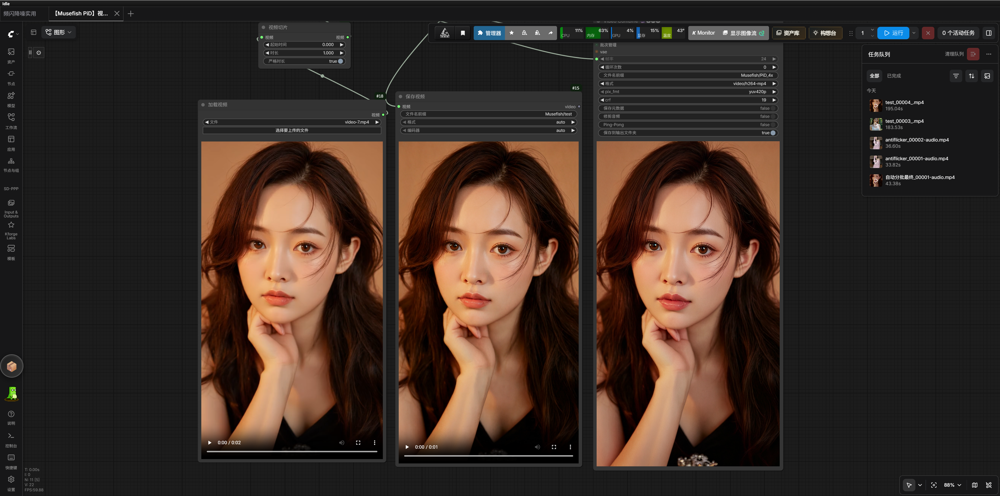

# PiD 视频超分与后处理

## 快速上手

处理顺序：`Musefish PiD Batch Video Upscale` → `Musefish AutoBatch Antiflicker` → `Musefish AutoBatch Image Sharpen FS` → `VHS_VideoCombine`。依赖 VideoHelperSuite（`VHS_LoadVideo`、`VHS_VideoCombine`）。模板：`workflows/Musefish_PiD_Batch_Video_Upscale.json`（UUID：`d7de7df1-0bb0-4cf8-bb1e-6f7ee7c5d1d2`）。

**重要：** 后处理节点处理 `IMAGE`，PiD 原始 `VIDEO` 不经过外部图像处理；最终应使用经处理的 `IMAGE` 接入 `VHS_VideoCombine` 后的输出，而非 PiD 原始 `VIDEO`。

## Musefish PiD Batch Video Upscale

节点 ID：`musefish_pid_batch_video_upscale`。批量处理输入 `IMAGE`，按原顺序输出超分 `VIDEO` 与 `IMAGE`，可将可选音频和 FPS 带入 `VIDEO`。

模型固定先将长边缩放至 `1024`，执行 `1024 → 4096` 全幅推理；`upscale_factor` 仅控制交付尺寸：`2` 为 2048、`3` 为 3072、`4` 为 4096 长边。VAE 预编码与采样分开执行；低分辨率 latent 暂存 CPU，4K 输出写入预分配 CPU 张量。OOM 时当前批次减半并保持同种子噪声和帧序；单帧仍失败则报错。不会对全幅 attention 做未经验证的空间切块。

参数与推荐值：

| 参数 | 推荐/默认值 | 说明 |
| --- | --- | --- |
| `batch_size` | `1` 起步；显存允许时 `2` 或 `4` | 显存不足优先降低；16GB 显卡不推荐 batch=3 测试设置。 |
| `pixel_chunk_size` | `1024`（默认）；`2048` 无有意义端到端收益 | 0 关闭内部优化；只分块像素 Transformer 的 MLP，attention 仍处理全幅。 |
| `attention_backend` | `Kitchen`（默认） | 仅影响本节点；缺少时记录日志并回退 `cuDNN`。显存依形状和批次变化，输出不保证逐像素一致。 |
| `upscale_factor` | `4` | 交付放大倍数。 |

其余参数保持默认：`latent_format=flux`、`degrade_sigma=0.0`、`cfg=1.0`、`sampler_name=lcm`、`scheduler=simple`、`steps=4`、`positive_prompt="high quality, ultra detailed, sharp details"`。

推荐模型路径：

```text
UNET: PiD\\pid_1.5_flux1_1024_to_4096_4step_int8_convrot.safetensors
CLIP: PixelDiT\\gemma_2_2b_it_elm_fp8_scaled.safetensors
encode_vae: Flux\\UltraFlux-v1-vae.safetensors
```

`encode_vae` 是唯一需连接的 VAE；无需 decode VAE，节点直接将像素空间结果以 CPU float32 从 [-1,1] 映射至 [0,1]。下载：UNET/CLIP <https://www.modelscope.cn/models/Comfy-Org/PixelDiT/files>；VAE <https://www.modelscope.cn/models/Comfy-Org/z_image_turbo/tree/master/split_files/vae>。

同条件短片实测（非速度承诺）：2 帧、2304×4096、同模型、4 steps、seed=0、batch=2、`pixel_chunk_size=1024`：Kitchen 13.7346 秒 / 9.72 GiB 分配显存；cuDNN 21.1101 秒 / 8.57 GiB。Kitchen 延迟低约 35%（约 1.54×）。旧 2 帧视觉对照 PSNR 51.6–51.8 dB，非逐像素相同，长运动质量未定。6 帧 batch=3：79.62 秒、12.81 GiB 分配、15.64 GiB 保留，输出不同于 batch=2，16GB 显卡不推荐。6 帧逆序复测 `pixel_chunk_size` 2048 对 1024：57.82 对 58.09 秒（约 0.46%差异），结果相同。不同素材、设备、分辨率、批次及模型加载状态会影响结果。

## Musefish AutoBatch Antiflicker

节点 ID：`musefish_autobatch_antiflicker`。对 `IMAGE` 执行前后帧对称、亮度引导时间双边滤波；每块重叠前后各 1 帧。按设备空闲内存自动分批，或手动固定批次；`device=auto` GPU 优先，单帧显存不足时降至 CPU，也可指定 `gpu` / `cpu`。输入分块处理后回到输入设备。实现于 `musefish_nodes.py`，不依赖或修改 VideoHelperSuite。

| 参数 | 默认值 | 说明 |
| --- | --- | --- |
| `luma_tmp` | `15` | 亮度时间相似度宽度。 |
| `chroma_tmp` | `20` | 色度时间相似度宽度。 |
| `frames_per_batch` | `0` | `0` 按设备空闲内存自动计算。 |
| `device` | `auto` | `auto` / `gpu` / `cpu`。 |

推荐 `15/20`、`device=auto`；16GB 参考模板用 `frames_per_batch=1` 限制显存峰值。快速运动检查拖影；主体拖影先降 `luma_tmp`，仅背景色跳变时单独提高 `chroma_tmp`。模板视频编码为 H.264 `yuv420p`；10-bit 需选择支持的编码器。

## Musefish AutoBatch Image Sharpen FS

节点 ID：`musefish_autobatch_image_sharpen_fs`。float32 频率分离锐化，含软阈值与亮度梯度边缘保护；Gaussian 低通用 OpenCV 浮点运算，median 大核用 SciPy 浮点滤波（较慢），人像推荐 Gaussian。

| 参数 | 默认值 | 说明 |
| --- | --- | --- |
| `method` | `hard` | `hard`（hard light）/ `linear`（linear light）。 |
| `blur_type` | `median` | `median` / `gaussian`。 |
| `intensity` | `6` | 低通核尺寸依据 intensity−1 取奇数，至少3；不是混合强度。 |
| `frames_per_batch` | `0` | `0` 按设备空闲内存自动计算。 |
| `device` | `auto` | `auto` / `gpu` / `cpu`。 |
| `amount` | `1.0` | 锐化残差强度，0–2；人像建议 `0.45`，0 不增强。 |
| `noise_threshold` | `0.0` | 残差软阈值，0–1；人像建议 `0.01`。 |

人像起点：`hard / gaussian / 6 / 1 / auto`、`amount=0.45`、`noise_threshold=0.01`。不要用强 `median/12` 制造锐度；不能保证修复所有模型伪影或恢复源片没有的细节。

## 长视频与连接

先将 `VHS_LoadVideo.frame_load_cap` 设为 `2` 或 `4` 验证，再增加帧数。PiD 显存不足先降 `batch_size`；保持 `seed`，确认 `encode_vae` 为 `Flux\\UltraFlux-v1-vae.safetensors`，避免 `force_rate` 或 `select_every_nth` 大幅抽帧。后处理虽支持自动分批及 OOM 缩批重试，但仍需整段 CPU 输入/输出存储；内存不足应缩短片段，显存紧张可用 `frames_per_batch=1` 或 `device=cpu`。

```text
VHS_LoadVideo IMAGE → PiD → Antiflicker(15/20/1/auto) → Sharpen(hard/gaussian/6/1/auto, amount=0.45, noise_threshold=0.01) → VHS_VideoCombine
VHS_LoadVideo AUDIO ─────────────────────────────────────────────────────────────────────────────→ VHS_VideoCombine audio
VHS_LoadVideo VHS_VIDEOINFO.FPS → PiD
PiD VIDEO → SaveVideo（原始、未经过后处理）
```

PiD 同一次执行在批次间复用固定噪声模板。推荐 `VIDEO` 接 `SaveVideo` 由 ComfyUI 编码并保存音频；需要后处理时用处理后的 `IMAGE` 链路。颜色校正模板可在 PiD `IMAGE` 后接 `ColorMatchToReference`，用 `ImageFromBatch(batch_index=0, length=1)` 作为首帧参考；默认 `match_strength=0.85`、`batch_size=4`，不能修复输入视频本身的亮度或内容闪烁。
### 后处理工作方式

`frames_per_batch=0` 按 GPU 空闲显存或 CPU 空闲系统内存估算批次；显式 `frames_per_batch` 固定每批帧数。去频闪预算也计入邻帧。输出预分配，避免 `list + cat` 的整段副本。OOM 时缩小当前批次重试、不跳帧；`auto` 可在单帧 GPU OOM 后回退 CPU，显式 `gpu` 不静默切换设备，其他异常和用户中断继续抛出。

去频闪张量在所选 GPU 或 CPU 运算，输入按块搬运并在处理后返回原输入设备。锐化 low-pass 在 CPU 执行；Gaussian 使用 OpenCV 浮点低通，小核 median 用 OpenCV、大核 median 用 SciPy 浮点中值滤波，避免 uint8 往返量化。

### 模板与输出说明

模板中的 `ColorMatchToReference` 位于 PiD `IMAGE` 后，`ImageFromBatch(batch_index=0, length=1)` 固定取输入首帧作为参考。默认 `match_strength=0.85`、`batch_size=4`，以首帧 LAB 均值/标准差为颜色基准，针对 PiD 帧间色偏频闪；不能修复输入本身的亮度或内容闪烁。关闭时断开颜色匹配并将 PiD 输出直接接视频合并节点。

PiD 输出像素空间结果直接 CPU float32 映射，无需 decode VAE；旧 `pixel_space` VAE 调度与中间低精度舍入不再使用。输入放大到模型尺寸使用浮点 `bicubic`，避免 PIL Lanczos 的 uint8 往返量化；缩小至模型尺寸及 2x/3x 交付缩放使用 `area`，编码前限制在 [0,1]。模型输入长边 `1024` 是内置约束，不需用户设置。

旧版案例：原视频 480×832（33 帧，约 2 秒）经 PiD 4x 至 2304×4096，再去频闪及 `hard/median/12` 锐化；不是当前人像推荐配置。

| 案例 | 文件 |
| --- | --- |
| 原视频 | [案例-原视频.mp4](../assets/案例-原视频.mp4) |
| 4 倍超分 + 后处理 | [案例-4倍超分.mp4](../assets/案例-4倍超分.mp4) |



## 视频相关文件

- `musefish_nodes.py`：PiD 超分、自动分批去频闪、频率分离锐化及扩展注册。
- `pid_runtime.py`：仅对兼容 PiD 像素块启用独立 MLP 分块；全幅 attention 不切图，模型 clone 临时补丁在成功、异常和中断后恢复。
### 日志与 backend

每批出现 `Model Initialization complete` 是 DynamicVRAM tqdm 首次更新的通用后缀，不代表权重每批都从磁盘重新加载。`attention_backend` 的显式覆盖只作用于本节点本次采样，不改 ComfyUI 全局 attention。

### 基本连接

`VHS_LoadVideo.IMAGE` 接 PiD，`AUDIO` 与 `VHS_VIDEOINFO.FPS` 可传入 PiD；`MODEL` 接 `UNETLoader`，`CLIP` 接 `CLIPLoader(type=pixeldit)`，`encode_vae` 接 `VAELoader(Flux\\UltraFlux-v1-vae.safetensors)`。PiD `VIDEO` 可接 `SaveVideo`，`IMAGE` 接预览或视频合并节点。

工作流：`workflows/Musefish_PiD_Batch_Video_Upscale.json`。相关实现：`musefish_nodes.py`、`pid_runtime.py`。
